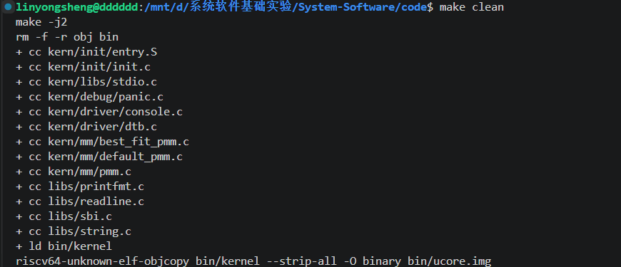
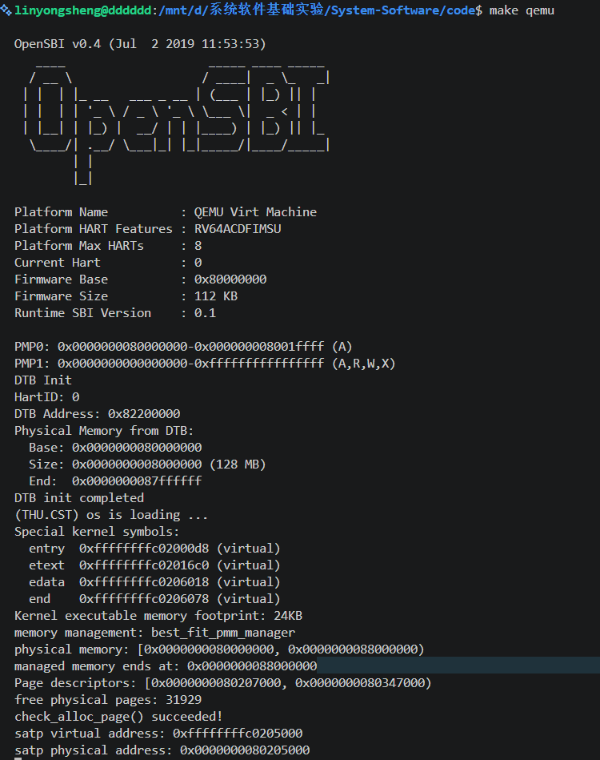
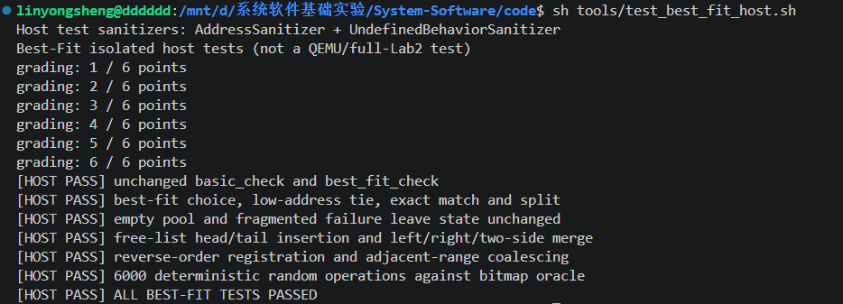
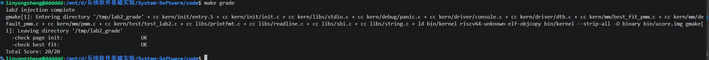

# 实验报告

## 实验基本信息

| 项目 | 内容 |
|------|------|
| **实验名称** | Lab 2: [物理内存和页表] |
| **小组成员** | 2511107-林永盛、2511592-陈逍宇、2513411-邱宇湛 |
| **完成日期** | 2026-10-23 |

### 小组分工

练习如何分工？

| 成员 | 负责的练习/模块 |
|------|----------------|
| 2511107-林永盛 | [功能模块二的任务一和任务二] |
| 2511592-陈逍宇 | [练习或模块名称] |
| 2513411-邱宇湛 | [练习或模块名称] |

实验报告如何分工？
| 成员 | 负责的部分 |
|------|----------------|
| 2511107-林永盛 | [一、实验目的 二、实验环境 三、实验整体逻辑分析 四、实验内容与实现 五、测试与验证] |
| 2511592-陈逍宇 | [四、实验内容与实现 五、测试与验证] |
| 2513411-邱宇湛 | [四、实验内容与实现 五、测试与验证] |
---

## 一、实验目的

本实验的主要目的是：

1. 理解 RISC-V Sv39 分页的基本原理，认识虚拟地址、物理地址、页表项和 `satp` 的关系，区分启动阶段已有的地址映射与运行时的物理页分配。

2. 掌握从设备树获取物理内存范围的方法，结合内核能够管理的地址上界、链接符号和页面对齐，确定可以交给分配器使用的完整物理页。

3. 理解 `struct Page` 描述符与物理页的对应关系，建立页描述符数组并保留 OpenSBI、内核镜像和描述符数组占用的页面，完成初始空闲区的注册。

4. 读懂 First-Fit 的初始化、查找、拆分、回收与合并过程，在统一物理内存管理接口下实现并接入 Best-Fit，分析不同选择策略的查找开销和碎片问题。

5. 按本章后续任务进一步学习 Buddy System 的页级分配和 SLUB 的对象分配，理解从连续物理页管理到不同大小内存对象管理的层次关系，并设计相应测试。

6. 使用标准四段式提示词描述功能接口、上下文和行为约束，通过源码检查、独立测试、QEMU 运行及课程评分验证 AI 生成的代码，避免只凭编译成功判断实现正确。

---

## 二、实验环境

你们使用的 AI 工具

| 成员 | AI 编程工具 | 底层模型 | 备注 |
|------|------------|---------|------|
| 2511107-林永盛 | Codex（终端 Agent） | GPT-6.1 Sol | 高 |
| 2511592-陈逍宇 | Codex(vsCode插件) | GPT-6 Astra | 中 |
| 2513411-邱宇湛 | Codex（终端 Agent） | GPT-6.1 Sol | 高 |

**说明：**
- **AI 编程工具**：指具体使用的终端工具、编辑器插件、桌面应用或浏览器界面
- **底层模型**：指该工具使用的大语言模型及版本

---

## 三、实验整体逻辑分析

### 3.1 本章节的逻辑主线

本章围绕“如何把探测到的物理内存组织成内核能够申请和归还的资源”展开。在 Lab1 能够启动内核的基础上，先理解地址翻译，再确定哪些物理页可用，最后通过分配器完成申请、拆分、回收和合并。

这里需要区分两件事：**地址映射解决通过哪个虚拟地址访问物理内存，物理页分配解决哪些页空闲、这次把哪些页交给调用者。** 当前 `entry.S` 已提供启动用的静态 Sv39 页表，设置 `satp` 后转入高地址内核运行；这不是分配器动态建立出来的页表，也不代表已经完成物理页管理。

本实验中，内核物理起始地址为 `0x80200000`，对应的链接虚拟地址为 `0xffffffffc0200000`。`page_init()` 必须区分这两种地址：`end` 和 `pages` 是虚拟地址，而可用区的边界按物理地址计算，需要通过 `PADDR` 等转换后才能比较和登记。

当前代码的主要初始化关系为：

```text
启动代码启用静态 Sv39 映射，进入 kern_init()
    ↓
清零 BSS，解析 DTB，得到物理内存范围
    ↓
pmm_init() → init_pmm_manager()：选择并初始化管理器
    ↓
page_init()：建立 Page 描述符，排除已占用区域
    ↓
init_memmap()：将完整空闲页交给当前管理器
    ↓
check_alloc_page()：通过申请与归还检查分配器
```

初始化后，调用者使用 `alloc_pages()`、`free_pages()` 和 `nr_free_pages()` 等统一接口，不必直接操作某一种算法的内部链表。不同算法通过 `struct pmm_manager` 注册自己的实现。

### 3.2 功能的逐步实现

**1. 理解分页与内核地址布局**

首先阅读入口汇编、链接脚本和地址转换宏，确认内核如何从物理加载位置转入高地址运行，以及 `satp` 如何指向内存中的根页表。已有映射保证内核能够访问管理结构，但不会自动记录页面的空闲与占用状态，因此还需要后续的物理内存管理模块。

**2. 获取内存范围并准备统一管理接口**

`kern_init()` 在清零 BSS 后调用 `dtb_init()`，保存设备树报告的内存起点和大小。随后 `pmm_init()` 先调用 `init_pmm_manager()`，选择管理器并初始化其内部状态。必须先完成这些准备，后面的 `page_init()` 才能知道管理范围，并将空闲页交给正确的分配器。

**3. 建立页描述符并登记空闲区**

`page_init()` 在内核镜像之后按页对齐安排 `Page` 描述符数组，每个描述符对应一个物理页。先把页面标记为保留，再排除 OpenSBI、内核和描述符数组的占用，并处理首尾对齐。只有剩余的完整空闲页面才能通过 `init_memmap()` 注册，避免把正在使用的页面重新分配出去。

**4. 从 First-Fit 理解流程，再实现 Best-Fit**

First-Fit 提供了空闲链表、块首页长度记录以及拆分和合并的参考实现；在理解这些机制后，Best-Fit 改为选择满足申请的最小空闲块，并保持其余状态约束。除了补齐管理函数，还要定义注册结构并切换 `init_pmm_manager()`，否则统一接口仍会调用原算法。

**5. 检查分配与回收是否形成闭环**

在内存初始化和管理器接入后，通过原有检查函数验证申请与归还，再补充最佳块选择、空链表、连续空间不足、拆分和双向合并等边界测试。编译、QEMU 自检和课程评分各有覆盖范围，需要结合检查，不能把某一项通过等同于整个 Lab2 全部完成。

**6. 按后续任务扩展到 Buddy 和 SLUB**

Buddy System 是另一种页级分配策略，按照 2 的幂管理块，通过拆分和伙伴合并组织空闲空间；它与 First-Fit、Best-Fit 都属于页级管理层，不是必须叠加在 Best-Fit 之上的算法。SLUB 则在页级分配提供的空间上组织较小对象，体现“先获得页，再管理页内对象”的分层思想。

---

## 四、实验内容与实现


### 功能模块一：物理内存初始化功能

**负责人：** [学号-姓名]

[待负责同学填写模块功能描述、最终提示词和实现迭代过程。]

---

### 功能模块二：物理内存分配功能

**任务一、任务二负责人：** 2511107-林永盛

#### 任务一：理解 First-Fit 连续物理内存分配算法

**结合上述函数，用自己的话简要说明 First-Fit 分配器如何初始化空闲页、分配连续物理页、回收页面并合并相邻空闲块。**

首先，`default_init()` 建立一个空的循环双向链表，并将总空闲页数 `nr_free` 清零。随后，`default_init_memmap(base, n)` 将交给分配器的连续 n 页登记为空闲页：清除这些页描述符的保留标志，将引用计数清零，用首页的 `property` 记录块的页数，再把首页节点按地址顺序加入空闲链表，使 `nr_free` 增加 n。链表只记录每个空闲块的首页，不会把块内每一页都单独挂入链表。

申请连续物理页时，`default_alloc_pages(n)` 从链表头开始查找，选择第一个能容纳 n 页的空闲块，而不是选择最小的块。恰好够用时取走整个块；块较大时，从低地址端分配 n 页，将剩余部分作为新的空闲块留在链表中。分配成功后清除已分配块首页的空闲块标志，并将 `nr_free` 减少 n；如果总空闲页不足，或虽然总数足够却找不到足够大的连续块，就返回 `NULL`。

回收页面时，`default_free_pages(base, n)` 重置这 n 页描述符的标志和引用计数，在首页记录归还的页数并设置空闲块标志，再按地址顺序插回链表，使 `nr_free` 增加 n。这些操作修改的是页面的管理信息，不是清空物理页中原来存放的数据。

插入后，分配器先检查前面的空闲块是否与归还范围在物理地址上连续，连续就合并长度、移除重复节点，并以较低地址的块作为合并后的起点；再检查后面的空闲块，以同样方式合并。合并依据是前一块的结束位置等于后一块的起始位置，而不只是两个节点在链表中相邻。合并只改变空闲块的组织方式，不会再次增加 `nr_free`。

**原有 First-Fit 是否有进一步的改进空间？**

有。线性查找的时间随空闲块数增加而增加，而且经常从链表头开始查找，可能使前部出现较多小碎片。可以用按大小分类的空闲链表或带有块大小信息的树加速查找，也可以比较 Next-Fit、Best-Fit 等选择策略对不同申请序列的影响，但这些策略不保证在所有情况下都更好。

回收时按地址插入、合并相邻块本来就是参考实现已有的设计，不能把它当成新增的优化。另外，当前参考代码的尾插分支在插入后没有立即退出遍历，存在再次处理已插入节点的风险；实现自己的分配器时应确保每次插入只执行一次。

#### 任务二：实现 Best-Fit 连续物理内存分配算法

##### 模块功能描述

**需要实现/修改的函数和注册结构：**

```c
// code/kern/mm/best_fit_pmm.c
static void best_fit_init(void);
static void best_fit_init_memmap(struct Page *base, size_t n);
static struct Page *best_fit_alloc_pages(size_t n);
static void best_fit_free_pages(struct Page *base, size_t n);
static size_t best_fit_nr_free_pages(void);
static void best_fit_insert_and_merge(struct Page *base); // 内部辅助函数
const struct pmm_manager best_fit_pmm_manager;

// code/kern/mm/pmm.c：选择并初始化 Best-Fit 管理器
static void init_pmm_manager(void);
```

**功能说明：**

分配器使用一个 `free_area_t` 保存空闲链表和总空闲页数，链表按物理地址递增排列。初始化时先建立空表，再把可用的连续物理页登记进来。登记和释放共用插入、合并辅助函数，保证一个范围只插入一次，并合并左右物理连续的空闲块。

分配时遍历空闲链表，在所有能满足要求的块中选择最小的一个；大小相同时选择地址较低的块。找到恰好匹配的块后可以提前结束搜索。选中的块大于申请量时，从低地址端取出所需页面，剩余部分留在原来的链表位置。分配失败不改变空闲状态。

仍以 8 页、5 页、10 页的三个空闲块为例，申请 4 页时，Best-Fit 选择 5 页块，分配后留下 1 页，而 First-Fit 会选择前面的 8 页块。

`best_fit_pmm_manager` 将上述函数注册到统一接口，`.check` 指向原有 `best_fit_check()`。`pmm.c` 的 `init_pmm_manager()` 改为选择这个管理器，使 `alloc_pages()`、`free_pages()` 等统一接口实际调用 Best-Fit。两个原测试函数保持原样，完成位置保留 `lab2` 注释，并将 `YOUR CODE` 替换为 `2511107`。

**Best-Fit 是否有进一步的改进空间？**

有。当前实现的分配查找为 O(k)，其中 k 是空闲块数；登记和释放还需要初始化 n 个页面的描述信息，并进行链表定位，总体为 O(n+k)，不新增随空闲块数量增长的辅助索引。可以维护按大小排序的树或大小分组，缩短查找最小合适块的时间，但需要同步维护地址信息，避免影响相邻块合并。Best-Fit 也可能留下很小的余块，可以进一步比较不同工作负载下的碎片情况；不能仅凭“剩余块最小”就认为整体碎片一定最少。

##### 最终提示词

以下是本次实际用于实现的完整四段式提示词，同时保存在 [prompt.md](./prompt.md) 中。

````markdown
[PROMPT]

**任务**：在当前 uCore Lab2 工程中，参考 `code/kern/mm/default_pmm.c` 的数据组织方式，在 `code/kern/mm/best_fit_pmm.c` 的 `lab2 function2-2 YOUR CODE` 标记处，实现完整的 Best-Fit 连续物理页分配器，并在 `code/kern/mm/pmm.c` 的 `init_pmm_manager()` 中选择 `best_fit_pmm_manager`。

**操作要求**：必须修改项目中的实际文件，而不是只展示代码。在标记区域中保留 `lab2 function2-2`，将 `YOUR CODE` 替换为 `2511107`。可以新增模块私有状态、宏和 static 辅助函数，不改变已有公开接口。保留 `basic_check()` 和 `best_fit_check()` 的内容，不修改测试断言、评分逻辑或测试脚本。不修改 First-Fit、模块一的 `page_init()`、Buddy、SLUB 或 Challenge，不提交或推送 Git。不要照搬参考文件中尾部插入后继续遍历的控制流；确保每次插入只执行一次。

**输出要求**：以真实头文件、链表实现和现成测试为准，使用下面的上下文、接口清单和行为规格实现代码。说明修改文件、算法选择、验证命令和实际结果。编译或集成若受未完成的 `page_init()` 阻碍，应如实报告依赖，并在不篡改正式代码和既有测试的前提下独立验证分配器；不得填充假日志、声称未执行的测试通过。

[RELY]

**工程及参考文件**：

- `code/kern/mm/default_pmm.c`：First-Fit 参考实现。
- `code/kern/mm/pmm.h`：分配器接口、页面引用计数和地址转换。
- `code/kern/mm/memlayout.h`：页描述符、空闲区类型、页面标志。
- `code/libs/list.h`：循环双向链表。
- `code/kern/mm/best_fit_pmm.h`：已声明 `extern const struct pmm_manager best_fit_pmm_manager;`。

与本任务直接相关的实际类型如下：

```c
struct Page {
    int ref;
    uint64_t flags;
    unsigned int property;
    list_entry_t page_link;
};

typedef struct {
    list_entry_t free_list;
    unsigned int nr_free;
} free_area_t;

struct pmm_manager {
    const char *name;
    void (*init)(void);
    void (*init_memmap)(struct Page *base, size_t n);
    struct Page *(*alloc_pages)(size_t n);
    void (*free_pages)(struct Page *base, size_t n);
    size_t (*nr_free_pages)(void);
    void (*check)(void);
};
```

**页面及地址约定**：

- `PGSIZE = 4096`，`PGSHIFT = 12`。每个 `Page` 描述符对应一个物理页；同一 `pages[]` 数组中相邻描述符对应相邻物理页，`base + n` 是向后移动 n 个描述符，不是地址加 n 字节。
- 只有空闲块首页的 `property` 记录块的页数，只有空闲块首页设置 `PageProperty` 并挂入空闲链表；块内部其他页不单独入链。
- `nr_free` 表示总空闲页数，不是空闲块数。分配返回页描述符，不返回原始物理地址。
- `PageReserved(p)` 表示保留页；`PageProperty(p)` 表示空闲块首页。可用 `SetPageProperty`、`ClearPageProperty`、`set_page_ref`、`page_ref`、`assert`。
- 链表可用 `list_init`、`list_empty`、`list_next`、`list_prev`、`list_add_before`、`list_add`、`list_del` 和 `le2page(le, page_link)`。`list_add` 在指定节点之后插入；`list_add_before` 在之前插入。
- 原有测试直接访问当前文件中的 `free_list` 与 `nr_free`，并且会临时保存/替换这些状态；实现须提供这两个名称，状态不能另存为测试不可见的副本。可仿照参考文件使用一个 static `free_area_t` 配合宏。
- 原有测试可能以不同粒度申请和归还合法的已分配页面；不要要求只能按先前完整分配块的同一边界归还。测试恢复环境时会整体归还先前已分配的连续范围。

[GUARANTEE]

必须实现的接口：

```c
static void best_fit_init(void);
static void best_fit_init_memmap(struct Page *base, size_t n);
static struct Page *best_fit_alloc_pages(size_t n);
static void best_fit_free_pages(struct Page *base, size_t n);
static size_t best_fit_nr_free_pages(void);

const struct pmm_manager best_fit_pmm_manager;
```

必须修改的现有接口：

```c
static void init_pmm_manager(void);  /* code/kern/mm/pmm.c */
```

将管理器指针设置为 `&best_fit_pmm_manager`，保留现有名称输出和初始化调用。注册结构的各回调必须分别对应上面五个接口，`.check` 指向原有 `best_fit_check`，名称为 `"best_fit_pmm_manager"`。若注册结构位于测试定义之前，可添加不改变函数内容的前置声明。

允许新增 static 辅助函数和私有宏、变量；不得改变 `struct Page`、`struct pmm_manager` 或已有测试。

[SPECIFICATION]

## 全局状态约束

- 空闲链表按物理页地址递增，每个空闲块恰有一个首页节点；块之间不重叠。
- 合法登记、分配和释放后，`nr_free` 等于各空闲块长度之和；测试临时替换链表的中间步骤以其自身约定为准，不额外强制跨步骤一致性。
- 登记或释放时合并相邻空闲块，使连续空闲范围不被无必要地分成多个节点。
- 页面管理信息的初始化不等于清空物理页的数据内容；本任务不要求擦除页面数据。
- 现有单核实验环境由调用方保证操作串行；不引入新的锁、动态堆分配或并发机制。

## best_fit_init

**Pre-Condition**：
- 在向此分配器交付物理页之前调用。

**Post-Condition**：
- 空闲链表成为合法空循环双向链表，总空闲页数为 0；可以开始登记空闲范围。

## best_fit_init_memmap

**Pre-Condition**：
- 管理器已初始化；`n > 0`；`base` 指向同一有效描述符数组中连续 n 页的起点。
- 这些页仍处于保留状态，且没有被本分配器登记、分配或与已有空闲区重叠。

**Post-Condition**：
- 这 n 页成为可分配页面，引用计数清零，总空闲页数恰好增加 n。
- 空闲链表仍有序、无重复节点；本范围与相邻空闲范围在连续时合并。

**Case 1**：
- 原链表为空时，登记为唯一空闲块，首页记录正确长度。

**Case 2**：
- 已有空闲块时，将范围登记到正确位置；不连续则保持独立，向前、向后或两侧连续则合并为一个块。

**Requirements**：
- 保留页检查失败或 `n=0` 属于调用约定错误，使用框架断言报告，不静默把保留的系统区域变为可分配页。

## best_fit_alloc_pages

**Pre-Condition**：
- 管理器已初始化，`n > 0`。

**Post-Condition**：
- 成功时恰好分配连续 n 页，返回首页描述符，分配范围不再作为空闲块出现，总空闲页数减少 n。
- 在所有能容纳 n 页的空闲块中选择长度最小者；长度相同时选择地址较低者。
- 失败时返回 `NULL`，空闲链表、块长度、标志和总空闲页数不变。

**Case 1**：
- 空链表、总空闲页不足，或总数足够但没有足够大的单个连续块时，返回 `NULL`。

**Case 2**：
- 最优块恰好为 n 页时，整块分配并移除对应空闲节点。

**Case 3**：
- 最优块大于 n 页时，从其低地址端分配 n 页，剩余部分成为有正确首页、长度和链表位置的空闲块。

**Requirements**：
- 不能在遇到第一个足够大的块时无条件结束查找；但找到恰好匹配的块后可以结束，因为不存在更小的合法候选。
- `n=0` 用断言拒绝，不产生零长度分配。

## best_fit_free_pages

**Pre-Condition**：
- `n > 0`；`base` 到 `base+n` 表示合法、连续、已分配且非保留的 n 页，不与已有空闲块重叠。
- 调用方保证没有使用中的引用，不重复释放。

**Post-Condition**：
- 本范围重新可分配，引用计数清零，总空闲页数恰好增加 n。
- 相邻空闲块合并，链表有序；只保留最终合并块首页的空闲块标志和节点。
- 合并只改变块组织方式，不重复增加总空闲页数。

**Case 1**：
- 与左右空闲块均不相邻时，插入为独立空闲块。

**Case 2**：
- 只与左侧或右侧空闲块相邻时，合并对应一侧，正确更新首页和长度。

**Case 3**：
- 同时与两侧相邻时，三个块合并为一个块，最终首页位于最低地址，两个旧边界不再作为独立节点。

**Requirements**：
- 链表相邻不等于物理页连续，合并必须依据页面范围相接。
- 不修改已经分配出去的相邻页，也不触碰原有测试函数。

## best_fit_nr_free_pages

**Pre-Condition**：
- 管理器已初始化。

**Post-Condition**：
- 返回当前总空闲页数，不改变任何页面或链表状态。

## best_fit_pmm_manager 与 init_pmm_manager

**Pre-Condition**：
- Best-Fit 各接口和原有检查函数已声明，公共接口与头文件一致。

**Post-Condition**：
- 常量注册结构的函数指针完整且类型正确。
- 内核通过统一分配接口实际使用 Best-Fit，并执行其原有检查函数，而非仍使用 First-Fit。

**Requirements**：
- 先通过原有 `basic_check`、`best_fit_check`，再在依赖齐备的情况下运行 `make`、QEMU 与 `make grade`。
- 建议额外验证：最佳块不在链首、等长候选、拆分、空链表、总数足够但不连续、首尾插入及前/后/双向合并。
- 不改测试来迎合实现；报告明确区分独立测试、完整内核测试和课程评分，记录真实通过或受阻状态。
````

##### 实现迭代过程

本任务使用一份完整提示词完成一次主要代码生成，随后进行源码复核、独立测试和内核集成验证。

**初始框架中的问题：**

原文件只提供 `basic_check()` 和 `best_fit_check()`，没有分配器状态、管理函数和注册结构，因此初始编译会出现 `free_list`、`nr_free` 未声明。仅补两个变量不能完成任务，还必须把五个管理接口、注册结构以及管理器选择一起补齐。

**实现与验证过程：**

1. 在提示词的 `[RELY]` 中列出真实的 `Page`、`free_area_t`、`pmm_manager` 和链表接口，并说明测试会临时保存和替换 `free_list`、`nr_free`。
2. 在 `[SPECIFICATION]` 中明确最小合适块、等长低地址优先、从低地址拆分、失败不改变状态，以及左右合并时不能重复计数。
3. 补齐代码后，先运行直接链接真实分配器的独立测试，再进行干净构建、QEMU 自检和课程评分。首次自动构建未找到非交互终端中的工具链路径；仅为验证进程补充已安装工具的路径后重新构建，没有因此改动分配算法或系统配置。

**最终结果：**

构建成功，QEMU 输出 `check_alloc_page() succeeded!`；独立测试运行原检查函数得到 `6/6`，补充边界测试和 6000 轮确定性随机操作全部通过，课程评分脚本结果为 `20/20`。

**关键改进点总结：**

将整个分配器作为一个完整任务描述，避免只实现分配而遗漏回收或注册；明确测试可见状态和插入一次的要求，避免照搬参考代码的控制流问题；同时使用原自测、补充测试和课程评分，区分它们各自能验证的范围。

#### 任务三：Buddy System（伙伴系统）分配算法

**负责人：** [学号-姓名]

[待负责同学填写模块功能描述、最终提示词和实现迭代过程。]

#### 任务四：任意大小的内存单元 SLUB 分配算法

**负责人：** [学号-姓名]

[待负责同学填写模块功能描述、最终提示词和实现迭代过程。]

---

### Challenge：硬件的可用物理内存范围的获取方法

**负责人：** [学号-姓名]

[待小组决定是否完成并填写。]

---

## 五、测试与验证

### 功能模块二·任务二：Best-Fit 连续物理内存分配算法


在 WSL 中按以下顺序复现本部分验证；运行 `make qemu` 后先截取运行画面并退出 QEMU，再继续执行后面的测试命令：

```bash
cd "/mnt/d/系统软件基础实验/System-Software/code"
make clean
make -j2
make qemu
# 截取运行画面并退出 QEMU 后，再执行：
sh tools/test_best_fit_host.sh
make grade
```

#### 1. 任务二：编译与镜像生成

执行 `make clean` 后运行 `make -j2`，输出显示各源文件完成编译，链接生成 ELF 文件 `bin/kernel`，再由 `objcopy` 生成 `bin/ucore.img`。



图 1：模块二任务二的代码完成干净构建，生成内核 ELF 文件及二进制镜像。


---

#### 2. 任务二：QEMU 内核运行与原自测

运行 `make qemu` 后，终端显示 `memory management: best_fit_pmm_manager`，随后输出 `check_alloc_page() succeeded!`，说明内核实际选中了 Best-Fit，并完成了该管理器的原有检查函数。

内核完成初始化后进入原有无限循环，因此成功输出后停留在该终端画面是预期行为，不代表自测失败。



图 2：模块二任务二的 Best-Fit 管理器在内核中启用，并通过原有分配回收自检。


---

#### 3. 任务二：独立边界测试与随机测试

运行 `sh tools/test_best_fit_host.sh`，直接编译并链接工程中的 `best_fit_pmm.c`，不复制分配算法，也不修改原自测。原检查在 `ucore_test` 条件下输出 `grading: 6 / 6 points`。补充测试覆盖最佳块不在链首、等长低地址优先、精确匹配、拆分、空链表、碎片导致的连续分配失败、首尾插入、单向/双向合并以及逆序登记。

随机测试使用 128 个模拟页描述符、固定初始种子 `0x2511107`，执行 6000 轮申请和合法的部分释放，每步与独立位图模型核对返回位置、空闲页数、块长度及链表关系。实际启用 AddressSanitizer 和 UndefinedBehaviorSanitizer，未报告错误。

这一测试验证分配器逻辑，不代替 RISC-V 启动和完整内核运行。



图 3：模块二任务二的原自测为 6/6，补充边界测试及 6000 轮位图对照随机测试全部通过。

---

#### 4. 任务二：课程集成评分

运行 `make grade`，结果为 `Total Score: 20/20`。评分按照工程现有 Makefile 在 `/tmp/lab2_grade` 临时副本中完成，没有修改课程评分标准。

本项是 Best-Fit 接入后的集成验证，评分同时包含模块一的页面初始化检查和模块二的 Best-Fit 管理器选择检查；20/20 不代表已经完成 Buddy、SLUB，也不能代替前面的分配策略与边界测试。



图 4：模块二任务二接入后的集成评分中，页面初始化和 Best-Fit 管理器检查均为 OK，总分为 20/20。


---

## 六、实验总结与收获

### 对操作系统的理解

#### 1. 本实验的重要知识点及其与 OS 原理的对应关系

结合本章的内存管理流程、First-Fit 源码分析和 Best-Fit 的实现与测试，我们认识到：内核能够访问一段内存，并不等于已经能够安全地分配这段内存。必须先确定可用范围，保留正在使用的区域，再用页描述符和分配器维护空闲状态，才能完成申请与归还。

| 本实验的重要知识点 | 对应的 OS 原理知识点 | 含义、关系与差异 |
|---|---|---|
| 启动阶段的 Sv39 映射、`satp` 与虚实地址转换 | 分页与地址翻译 | 页表将虚拟地址映射到物理地址，`satp` 保存根页表的物理页号等信息，而不是保存整张页表。本实验使用入口代码已有的静态映射进入高地址内核；物理页分配是在此基础上记录和分配空闲页，两者不能混为一谈。 |
| 设备树中的内存范围与保留区 | 内存探测与系统资源管理 | 设备树报告物理内存起点和大小，但这不意味着所有页面都能分配。OpenSBI、内核和页描述符数组已经占用的空间必须排除，还要处理管理上界和页面对齐。 |
| `struct Page`、`property` 和空闲链表 | 物理页管理与分配器元数据 | `Page` 是描述物理页状态的结构，不是物理页本体。链表只连接空闲块首页，首页的 `property` 记录块长，`nr_free` 统计总空闲页数而非节点数。修改这些信息不等于清空物理页的数据。 |
| First-Fit 与 Best-Fit 的选择规则 | 连续分配策略与外部碎片 | First-Fit 选择按地址查找时遇到的第一个合适块，Best-Fit 选择最小的合适块。当前两种链表实现的最坏查找均为 O(k)，其中 k 是空闲块数；Best-Fit 可能留下很小的余块，不能认为它一定更快或在所有申请序列下碎片更少。 |
| 空闲块的拆分与相邻合并 | 动态分区管理与资源回收 | 大块按需拆分，回收时按照物理连续关系合并左右空闲块。合并只改变块的组织方式，不会搬动已分配页面，也不能把隔着已分配页的两个空闲块拼成连续空间；合并本身不重复增加总空闲页数。 |
| `struct pmm_manager` 与统一调用接口 | 内核模块化与机制、策略分离 | `alloc_pages()` 等接口提供统一入口，各算法通过管理器注册自己的实现。补齐 Best-Fit 函数后，还必须切换管理器，才能让实际调用使用新算法；只定义函数而不接入并不等于功能生效。 |

一个直接的认识是：总空闲页数足够，不代表连续分配一定成功。例如两个互不相邻的空闲块各有 2 页，虽然总共空闲 4 页，申请连续 3 页仍会失败。因此，检查分配器时既要核对总页数，也要核对每个块的长度和位置。

#### 2. OS 原理中重要，但本实验当前尚未实现或验证的知识点

1. **完整的动态虚拟内存管理。** 当前已有启动用的静态映射，但尚未实现完整的运行时建表、缺页处理、按需分配、换入换出和页面置换。分配到物理页也不等于已经把它映射到某个用户地址空间。
2. **进程地址空间隔离与保护。** 当前没有为多个用户进程建立独立页表，也未验证 ASID、进程切换和跨地址空间访问保护。理解这些概念与实际完成隔离机制是不同的。
3. **并发访问下的分配器同步。** 当前验证在单核、串行调用条件下完成，没有实现多核同时申请和归还时的锁或其他同步机制，测试通过不能证明分配器在并发环境下也正确。
4. **更高层次的内存分配。** Buddy 和 SLUB 是本章后续任务：前者按 2 的幂组织页级块，后者在页级空间上管理较小对象。当前 Best-Fit 的测试结果不能作为这两项任务已经实现或通过测试的依据。
5. **其他操作系统子系统。** 本次工作主要围绕物理内存分配，没有实现进程调度、用户态系统调用、文件系统和持久化存储等完整功能，不能把内存自检成功理解为整个操作系统已经完成。

### AI 协作开发的经验

本次 AI 协作主要用于把接口、状态和边界条件组织成清楚的实现要求，再通过真实代码与运行结果核对生成内容。结合本次过程，我们有以下体会：

1. **提示词要以工程中的真实定义为依据。** `[RELY]` 中提供 `Page`、`free_area_t`、`pmm_manager` 和链表接口，能够减少 AI 猜测字段、宏名或调用约定。测试还会直接保存和替换 `free_list`、`nr_free`，这一约束也需要说明，否则新增的隐藏状态可能与原测试不兼容。
2. **按完整功能组织任务，不能只补眼前的编译错误。** 原框架缺少的不只是两个变量，还包括初始化、登记、分配、回收、计数、注册结构和管理器切换。用一份提示词覆盖这些相互关联的部分，比只要求“解决未声明错误”更容易形成完整实现。
3. **行为规格要明确成功、失败与状态变化。** 在 `[SPECIFICATION]` 中写清最小合适块、等长低地址优先、拆分后的余块、失败时不改变状态，以及合并不能重复计数，能让 AI 的实现和后续检查都有明确依据。提示词不仅要说“实现 Best-Fit”，还要说明什么样的行为才算正确。
4. **验证需要分层，不能只看编译或分数。** 原自测、补充边界测试和固定种子的 6000 轮位图对照随机测试用于检查分配器行为，QEMU 用于验证内核中的实际接入，课程评分用于核对现有评分项。ASan/UBSan 只在宿主机独立测试中启用，不能写成内核也启用了检测；这些有限测试也不等于对所有输入的正确性证明。
5. **保留原测试和真实运行证据。** 本次没有为通过检查而修改原测试函数，最终截图直接来自实际终端输出，而不是把预期结果重新排版成图片。报告中的命令、截图和结果应能相互对应。
6. **先区分环境问题与算法问题，再控制修改范围。** 自动构建未找到工具链时，应先核对终端环境和路径，不应直接改动内核算法。实现与报告都要说明当前工作的范围，不把尚未完成的任务或仅在理论上了解的机制写成已验证的结果。

总体而言，AI 可以帮助整理思路、补齐代码和设计检查，但最终仍需要我们读懂关键状态变化，并用源码与真实测试判断实现是否符合要求。本次最重要的收获，是能说明一次申请从哪个空闲块取页、拆分后留下什么，以及归还后怎样恢复连续空闲空间，而不只是看到程序输出“通过”。

---

