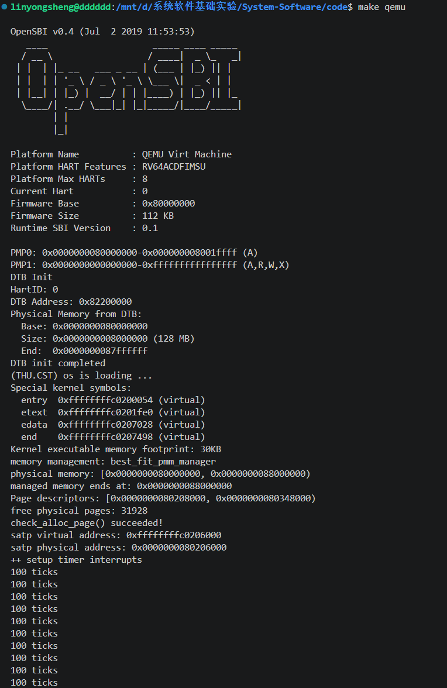
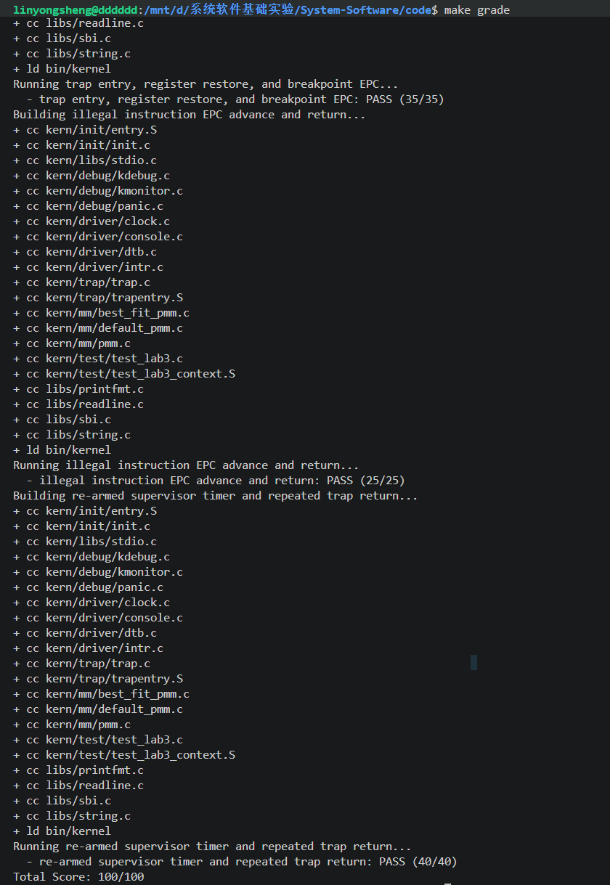

# 实验报告

## 实验基本信息

| 项目 | 内容 |
|------|------|
| **实验名称** | Lab 3：断，都可以断（中断与异常处理） |
| **小组成员** | 2511107-林永盛、2511592-陈逍宇、2513411-邱宇湛 |
| **完成日期** | 2026-10-30 |

### 小组分工

练习如何分工？

| 成员 | 负责的练习/模块 |
|------|----------------|
| 2511107-林永盛 | [功能模块一] |
| 2511592-陈逍宇 | [功能模块二] |
| 2513411-邱宇湛 | [功能模块二] |

实验报告如何分工？
| 成员 | 负责的部分 |
|------|----------------|
| 2511107-林永盛 | [一、实验目的 二、实验环境 三、实验整体逻辑分析 四、实验内容与实现 五、测试与验证] |
| 2511592-陈逍宇 | [四、实验内容与实现 五、测试与验证] |
| 2513411-邱宇湛 | [四、实验内容与实现 五、测试与验证] |

---

## 一、实验目的

本实验的主要目的是：

1. 理解 RISC-V 中断与异常的基本机制，认识 M、S、U 模式的关系，以及 `stvec`、`sstatus`、`sepc`、`scause` 等 CSR 在 Trap 进入和返回过程中的作用。
2. 掌握上下文保存与恢复的方法，结合 `SAVE_ALL` 和 `struct trapframe` 的真实布局实现 `RESTORE_ALL`，正确处理原栈指针、通用寄存器及 Trap 返回状态。
3. 完成汇编入口与 C 语言处理函数的衔接，将 Trap frame 按 RISC-V 调用约定传给 `trap()`，形成“进入、保存、处理、恢复、返回”的完整执行流程。
4. 实现中断与异常的分类处理，掌握时钟事件重设、中断计数、周期输出和规定条件下的关机流程；理解非法指令和断点异常的识别，以及按实际指令长度更新返回位置的方法。
5. 理解中断使能与临界区保护的关系，掌握保存中断原状态、关闭中断和恢复原状态的用途及适用范围。
6. 按四段式框架设计 Prompt 和行为规格，在阅读真实接口的基础上使用 AI 辅助实现，通过编译、内核运行和课程测试检查各模块的配合情况。

---

## 二、实验环境

你们使用的 AI 工具

| 成员 | AI 编程工具 | 底层模型 | 备注 |
|------|------------|---------|------|
| 2511107-林永盛 | Codex（终端 Agent） | GPT-6.1 Sol | 高 |
| 2511592-陈逍宇 | Codex (Vs Code插件) | GPT-6.1 Sol | 高 |
| 2513411-邱宇湛 | Codex（终端 Agent） | GPT-6.1 Sol | 高 |

**说明：**
- **AI 编程工具**：指具体使用的终端工具、编辑器插件、桌面应用或浏览器界面
- **底层模型**：指该工具使用的大语言模型及版本

---

## 三、实验整体逻辑分析

### 3.1 本章节的逻辑主线

本章围绕“发生中断或异常后，内核如何接管执行并正确返回”展开。在前面实验能够启动内核和管理物理内存的基础上，本实验补上 Trap 的上下文管理和具体事件处理，使内核能够响应突发事件，而不是只按原来的指令顺序一直运行。

整个过程分为硬件记录、汇编保存恢复和 C 语言处理三个环节。硬件先记录 Trap 原因、返回位置和相关状态，并进入 `stvec` 指定的入口；`trapentry.S` 再把通用寄存器和相关 CSR 快照保存在当前栈上；`trap.c` 根据原因分发到中断或异常处理函数。处理结束后，从同一份 Trap frame 恢复状态，通过 `sret` 返回。

主要执行关系为：

```text
kern_init() 完成启动准备，idt_init() 设置 Trap 入口
    ↓
clock_init() 设置首次时钟事件，intr_enable() 开启中断
    ↓
发生交给 S 模式处理的中断或异常
    ↓
硬件记录返回位置、原因和状态，跳到 __alltraps
    ↓
SAVE_ALL：保存现场，sp 指向当前 Trap frame
    ↓
通过 a0 传递帧地址，调用 trap(tf)
    ↓
trap_dispatch(tf) 判断类型
    ├─ interrupt_handler(tf)：处理中断
    │      └─ 时钟事件重设、计数、周期输出及规定条件下关机
    └─ exception_handler(tf)：处理异常
           └─ 非法指令、断点及兜底处理，按要求更新 epc
    ↓
处理函数返回，继续进入 __trapret
    ↓
RESTORE_ALL 恢复现场，sret 返回指定执行位置
```

时钟中断是异步事件，处理后通常继续执行被打断的代码；非法指令和断点是当前指令引起的同步异常，按本实验要求处理后要调整 `epc`，避免再次执行同一条异常指令。两者共用入口和现场管理机制，但具体处理行为不同。

### 3.2 功能的逐步实现

**1. 复用内存管理基础，准备 Trap 处理入口。**

将 Lab2 完成的物理内存初始化和 Best-Fit 实现迁入对应位置，保留 Lab3 新增的中断保护包装。`idt_init()` 设置 `sscratch` 的初始状态，并将 `__alltraps` 的地址写入 `stvec`。这里虽然沿用 IDT 的命名，实际是配置 RISC-V 的统一 Trap 入口，不是建立 x86 的中断描述符表。

**2. 按已有保存关系实现上下文恢复。**

先核对 `SAVE_ALL` 与 `struct trapframe`，确认 RV64 下帧大小为 288 字节，旧 `sp` 位于第 2 号槽位。恢复时取出帧内的返回状态，恢复通用寄存器，最后恢复 `sp`，保证整个读取过程中帧基址有效。这个环节是处理结束后能够继续运行的基础。

**3. 建立汇编入口与 C 函数之间的调用关系。**

保存完成后，通过 `a0` 将当前帧地址传给 `trap(struct trapframe *tf)`。C 函数访问的是汇编已经保存的同一份上下文，不是再建立一个副本。C 返回时保持调用前的栈指针，使程序能够继续进入 `__trapret`。

**4. 完成中断和异常的具体处理。**

`trap_dispatch()` 根据原因区分中断和异常。时钟中断每次都设置下一次事件，并维护 `ticks`、按规定输出统计信息和关机；非法指令和断点异常输出相应信息，结合实际指令长度调整 `tf->epc`。未要求恢复的其他异常通过输出 Trap frame 辅助诊断。这样既能识别事件，也能与后续返回路径衔接。

**5. 将上下文管理与事件处理集成验证。**

上下文恢复决定寄存器和执行位置能否正确恢复，具体处理函数决定事件如何处理以及是否需要改变返回位置，两者必须一起配合。验证时先检查编译和各模块行为，再通过 `make qemu` 观察内核输出，通过 `make grade` 检查课程用例；编译运行和评分截图统一放在第五部分。

---

## 四、实验内容与实现

### 功能模块一：Trap 上下文恢复与 Trap 入口功能

**负责人：** 2511107-林永盛

#### 模块功能描述

**需要实现/修改的汇编接口：**

```asm
# kern/trap/trapentry.S
.macro RESTORE_ALL
    # 恢复当前 Trap frame
.endm

__alltraps:
    SAVE_ALL
    # 将当前 Trap frame 传给 C 函数 trap()
```

**与之衔接的已有接口：**

```c
void trap(struct trapframe *tf);
```

已有 `__trapret` 调用 `RESTORE_ALL`，随后执行 `sret`。本模块不修改 `SAVE_ALL`、结构体定义、C 处理函数签名或教师测试。

**功能说明：**

这个模块负责把“硬件进入 Trap 入口”和“C 语言完成事件处理”连接起来。已有保存逻辑把寄存器和 Trap 信息写入栈，补全后的入口把这块内存的地址传给 `trap()`；处理结束后，再从同一份 Trap frame 恢复现场，使 CPU 能够继续执行。

#### 关键状态和实现步骤

**1. Trap frame 的布局**

RV64 中一个寄存器宽度为 8 字节，共有 32 个通用寄存器槽位和 4 个 CSR 快照槽位，总大小为 `36 × 8 = 288` 字节。

| 槽位 | 字节偏移 | 保存内容 |
|------|----------|----------|
| 0 | 0 | x0，固定为 0 |
| 1 | 8 | x1，即 ra |
| 2 | 16 | 被打断时的 x2，即原 sp |
| 3～31 | 24～248 | x3～x31 |
| 32 | 256 | sstatus 快照，对应 status |
| 33 | 264 | sepc 快照，对应 epc |
| 34 | 272 | sbadaddr 快照，对应 badvaddr |
| 35 | 280 | scause 快照，对应 cause |

`SAVE_ALL` 先将原 `sp` 放入 `sscratch`，再将栈指针减小 288 字节。此后当前 `sp` 是帧基址，不是原来的栈指针。保存逻辑通过 `s0` 取回原值，写入第 2 号槽位；`s0` 是 x8，不是固定为 0 的 x0。

**2. RESTORE_ALL：先恢复返回信息，最后恢复 sp**

先读取第 32、33 号槽位，写回 `sstatus` 和 `sepc`。这里恢复的是帧内当前的值，如果处理函数修改了 `tf->epc`，返回时就采用修改后的地址。

接着恢复 x1、x3～x31，最后执行：

```asm
LOAD x2, 2*REGBYTES(sp)
```

最后才恢复 `sp`，是因为前面的加载都使用它定位 Trap frame。如果过早改变它，后续寄存器就会从错误的位置读取。这里直接使用保存槽中的原栈指针，不把固定加上 288 字节当成替代方案。

x0 由硬件固定为 0，不需要恢复；`badvaddr`、`cause` 是供处理和诊断使用的快照，不需要写回相应 CSR。`sret` 会按照恢复后的状态执行权限级和中断状态转换，因此不能把它理解为普通函数的 `ret`，也不能假定返回后的 `sstatus` 每一位都与帧内值完全相同。

**3. __alltraps：传递地址，不复制上下文**

在已有 `SAVE_ALL` 后补入：

```asm
mv a0, sp
jal trap
```

RISC-V ABI 使用 `a0` 传递第一个参数，所以这里把当前帧基址交给 `trap(struct trapframe *tf)`。C 函数通过 `tf` 访问同一份现场。普通调用会改变 `ra`，但原 `ra` 已被保存，之后由恢复宏取回。

C 函数返回后，`sp` 仍应指向调用前的帧基址，随后自然进入已有的 `__trapret`。288 字节是 16 的整数倍，因此在原栈对齐的前提下，进入 C 函数时仍满足栈对齐要求。

两个完成位置都保留 `lab3 function1` 注释，并将 `YOUR CODE` 替换为 `2511107`。模块二作为集成依赖在 `trap.c` 中单独补齐，使用 `lab3 function2 2511107` 标记，模块一的保存布局和返回路径保持不变。

#### Spec 与 Prompt 的设计思路

先阅读已有 `SAVE_ALL` 和 `trap.h`，把真实的寄存器顺序、槽位偏移、原 sp 的保存位置和 C 函数签名写入 [RELY]。这里的布局来自工程，不是先假设一个结构体再让汇编去匹配。将“恢复现场”和“汇编调用 C”作为一个完整模块放进同一份提示词，因为二者必须共享同一份 Trap frame 和返回路径。

[PROMPT] 说明目标文件、两个填空位置及禁止修改的范围；[GUARANTEE] 列出 `RESTORE_ALL` 和 `__alltraps` 两个交付接口。二者是汇编宏和入口标签，不能虚构成普通 C 函数签名。

行为规格分别从以下方面描述：

| 规格部分 | RESTORE_ALL | __alltraps |
|----------|-------------|------------|
| Pre-Condition | 当前 sp 指向有效帧，C 处理已结束，返回状态有效，恢复期间保持中断关闭 | 已进入 S 模式 Trap 入口，当前内核栈有效、空间充足且对齐，已有保存宏可用 |
| Post-Condition | 从帧中恢复通用寄存器及返回 CSR，为后续 sret 准备正确状态 | 保存一份现场，把它的地址交给 trap()，返回时仍能访问同一份帧并进入 __trapret |
| Case | 区分处理函数未改返回状态和已修改 epc 等内容，要求两种情况都以帧内当前值为准 | 保存、调用、返回是同一条正常执行路径，不为了套格式编造其他 Case |
| Requirements | 不提前改变帧基址，不遗漏临时寄存器，不能在现场尚未恢复时开启中断 | 遵守 a0 参数和栈对齐约定，使用能返回的调用，不复制上下文、不修改已有接口 |

规格重点描述输入条件、应达到的状态和必须保持的约束，不要求某一种固定的寄存器加载顺序。代码中“先写回 CSR、最后恢复 sp”是满足这些约束的一种实现。独立测试用有效帧地址、保存值、返回后的寄存器及修改后的 epc 检查这些规格，而不是仅确认某几条指令是否出现。

#### 最终提示词

以下是经过迭代优化后，最终成功实现该功能的提示词：

````markdown
[PROMPT]

**任务**：在当前 uCore Lab3 工程中，修改 `code/kern/trap/trapentry.S`，完成“功能模块一：Trap 上下文恢复与 Trap 入口功能”。补全 `RESTORE_ALL` 汇编宏，以及 `__alltraps` 中从已有 `SAVE_ALL` 到 C 函数 `trap(struct trapframe *tf)` 的调用衔接，和已有 `__trapret`、`sret` 共同形成保存、处理、恢复、返回的闭环。

**操作要求**：必须修改项目中的实际文件，而不是仅展示代码。只在本模块两个 `lab3 function1 YOUR CODE` 标记位置补全，保留 `lab3 function1` 注释并将 `YOUR CODE` 替换为 `2511107`。不得修改 `SAVE_ALL`、`struct pushregs`、`struct trapframe`、`trap()` 的签名、现有 `__trapret` 返回路径和教师测试；不得实现队友负责的 `interrupt_handler()`、`exception_handler()` 或 Challenge，不提交或推送 Git。

**输出要求**：根据下面的 [RELY]、[GUARANTEE] 和 [SPECIFICATION] 完成文件操作，以当前工程的真实定义为准。说明修改位置、关键恢复顺序及实际验证结果。若完整构建受到模块二未完成的影响，应明确报告这一依赖；可以用独立测试入口验证本模块，但不得把测试入口写入正式模块二，也不得声称完整 Lab3 已通过。不要生成或伪造终端截图。

[RELY]

1. 首先读取实际文件：
   - `code/kern/trap/trapentry.S`：已有保存逻辑、待补全位置和返回路径；
   - `code/kern/trap/trap.h`：上下文结构和 C 层接口；
   - `code/libs/riscv.h`：寄存器宽度、内存访问宏和 CSR 定义；
   - `code/libs/defs.h`：`uintptr_t`；
   - `code/kern/trap/trap.c`：`trap()` 的调用约定和分发关系。

2. 当前目标为 RV64。相关宏的实际定义为：
```c
#define STORE sd
#define LOAD ld
#define LOG_REGBYTES 3
#define REGBYTES (1 << LOG_REGBYTES)
typedef uint64_t uintptr_t;
```
以上 STORE、LOAD、LOG_REGBYTES 对应 `__riscv_xlen == 64` 分支。

3. `struct pushregs` 按 x0 至 x31 的顺序包含 32 个 `uintptr_t` 字段：
```text
zero, ra, sp, gp, tp, t0, t1, t2, s0, s1,
a0, a1, a2, a3, a4, a5, a6, a7,
s2, s3, s4, s5, s6, s7, s8, s9, s10, s11,
t3, t4, t5, t6
```
`trap.h` 中的实际结构及接口为：
```c
struct trapframe {
    struct pushregs gpr;
    uintptr_t status;
    uintptr_t epc;
    uintptr_t badvaddr;
    uintptr_t cause;
};
void trap(struct trapframe *tf);
```
因此，Trap frame 共占 36 * REGBYTES，即 RV64 下的 288 字节：
   - 槽位 0～31：对应 x0～x31；
   - 槽位 32：status；
   - 槽位 33：epc；
   - 槽位 34：badvaddr；
   - 槽位 35：cause。
槽位 i 相对帧基址的字节偏移为 i * REGBYTES。

4. 已有 `SAVE_ALL` 先将旧 sp 暂存在 `sscratch`，再在当前栈上分配 Trap frame。它将原 sp 写入槽位 2，并把 `sstatus/sepc/sbadaddr/scause` 的快照写入槽位 32～35；保存后当前 sp 指向帧基址，`sscratch` 为 0。不要把此时的 sp 当作被打断时的 sp。

5. 现有返回路径为：
```asm
__trapret:
    RESTORE_ALL
    sret
```
RISC-V 调用约定使用 a0 传递第一个参数，C 函数返回时应保持其调用前的 sp。本模块按已有框架提供可用、16 字节对齐的当前内核栈处理 Trap，不要求实现独立用户栈切换、进程调度或浮点上下文管理。

[GUARANTEE]

必须补全以下两个现有汇编接口，保留名称和布局：
```asm
.macro RESTORE_ALL
    # lab3 function1 2511107
.endm

.globl __alltraps
__alltraps:
    SAVE_ALL
    # lab3 function1 2511107
    # 调用现有 void trap(struct trapframe *tf)
```

- `RESTORE_ALL`：从当前 Trap frame 恢复通用寄存器和 Trap 返回所需的状态。
- `__alltraps`：在保存上下文后，将同一份 Trap frame 作为参数交给 `trap()`，返回后衔接已有恢复路径。
- 不增加或改变公开 C 接口；可在填空区域增加必要注释，不新增无关全局状态或硬编码返回地址。

[SPECIFICATION]

## RESTORE_ALL

**Pre-Condition**：
- 当前 sp 指向由已有 SAVE_ALL 形成的有效 Trap frame，所有槽位可读取。
- C 层处理已结束，返回用的 epc、status 以及通用寄存器槽位是有效状态；处理函数可能更新其中的内容。
- 当前处于 S 模式的 Trap 返回路径，尚未执行 sret。
- 帧内 status 的 SIE 位保持为 0，使恢复现场期间不响应 S 模式中断；返回后的中断开关状态通过 SPIE 和 sret 恢复。

**Post-Condition**：
- x1、x3～x31 从各自槽位恢复，x2 从槽位 2 恢复；x0 始终保持硬件规定的 0。
- sstatus、sepc 取自帧中当前的 status、epc，供紧随其后的 sret 使用。
- 栈指针不再指向本次 Trap frame，后续返回使用帧内记录的 sp。
- badvaddr 和 cause 作为诊断快照保留在帧中，不要求反写相应 CSR；不额外恢复 sscratch 中的旧 sp。

**Case 1**：C 处理函数未修改返回相关内容时，恢复保存的状态，使 sret 能返回被打断的执行流。

**Case 2**：C 处理函数修改了 epc 或其他允许修改的返回状态时，恢复修改后的值，而不是固定跳到原始异常位置，也不在恢复宏中自行计算异常指令长度。

**Requirements**：
- 在所有基于帧基址的内存读取完成之前，不能提前恢复 sp。
- 用作恢复 CSR 的临时通用寄存器，最终也必须恢复其帧内值，不能因临时使用而破坏被打断代码的寄存器。
- 不自行开启中断，不以普通 ret 替代 sret，不修改保存布局。
- RESTORE_ALL 负责准备返回状态；sret 对权限级和状态位的体系结构更新由现有返回指令完成，不等同于逐位保持 sstatus 不变。

## __alltraps

**Pre-Condition**：
- CPU 已进入 S 模式 Trap 入口，硬件已记录相关 Trap CSR。
- 当前栈有效、空间足够且对齐，已有 SAVE_ALL 可正常工作。
- C 层提供 void trap(struct trapframe *tf)，调用遵循 RISC-V ABI。

**Post-Condition**：
- 使用已有 SAVE_ALL 保存现场，只形成一份 Trap frame。
- trap() 的第一个参数准确指向这份帧，不传递帧副本或错误偏移。
- trap() 返回时，sp 仍指向相同帧基址，接着进入已有 __trapret，恢复后执行 sret。
- trap() 对帧内返回状态的合法修改不会被另一份旧副本覆盖。

**Requirements**：
- 进入 C 函数时保持 16 字节栈对齐；RV64 下帧大小为 288 字节，是 16 的整数倍。
- 不把 Trap 入口实现成不会返回的尾调用，不覆盖已有 C 分发逻辑，不增加另一份完整上下文。
- 保留原 SAVE_ALL 和 __trapret，不承诺当前框架尚未提供的 U 模式独立内核栈切换或中断嵌套支持。

## 验证要求

- 使用工程编译选项编译 trapentry.S，并检查目标代码中的参数传递、CSR 恢复及最后恢复 sp 的顺序。
- 验证进入 C 处理函数时的帧地址与布局、寄存器保存恢复、处理函数修改 epc 后的返回，以及多次 Trap 返回。
- 独立测试可以提供仅用于验证的 trap()；它验证模块一，不代表完成模块二。
- 完整工程 make、make qemu、make grade 需要两个模块及 Lab2 依赖都就绪；仅在实际成功后记录相应结论。
````

#### 实现迭代过程

本模块的实现经历了 [3] 次迭代，过程如下：

---

##### 第一次迭代：实现模块一并补齐启动依赖

**遇到的问题：**

- Lab3 的 `pmm.c`、`best_fit_pmm.c` 仍是 Lab2 占位状态，无法直接作为完整启动依赖。
- 从 Lab2 迁入的 `page_init()` 使用 `KERNEL_BEGIN_PADDR` 和 `PHYSICAL_MEMORY_END`，当前 Lab3 头文件没有这两个名称，定向编译报告宏未定义。
- 完整 `make` 在 `trap.c` 中报告 `interrupt_handler`、`exception_handler` 的隐式声明错误，原因是模块二尚未实现，而不是模块一汇编语法错误。

**问题解决策略：**

- 只迁移 Lab2 对应的实现块和 Best-Fit 注册结构，保留 Lab3 新增的关中断包装及原有测试。
- 在物理内存初始化内部，根据 Lab3 已有的 `KERNBASE`、`KERNTOP` 和 `PHYSICAL_MEMORY_OFFSET` 计算物理边界，没有复制旧头文件或引入 Buddy、SLUB。
- 该阶段先通过独立入口验证真实 `trapentry.S`，将上下文管理与具体事件处理分开定位；第三次迭代再补齐模块二，进行完整内核验证。

##### 第二次迭代：核对独立测试的断言范围

**遇到的问题：**

独立测试初版检查 `sret` 后 `SPIE = 1`，但本次 QEMU 4.1.1 实测为 0。这条断言符合 RISC-V 规范，不能因为测试失败就把规范要求认定为错误：规范规定 `SIE ← SPIE`，随后 `SPIE ← 1`，并将 `SPP` 清零。见 [RISC-V 特权规范](https://docs.riscv.org/reference/isa/priv/supervisor.html)。

**问题解决策略：**

进一步核对 [QEMU v4.1.1 上游的 helper_sret 实现](https://github.com/qemu/qemu/blob/v4.1.1/target/riscv/op_helper.c#L68-L94)，可见该版本将 `SPIE` 清为 0，与本次观测一致。报告据此区分体系结构规范与旧版模拟器实现，没有把这一差异当成模块一恢复代码的错误。

模块一的独立回归检查保留 `SIE`、`SPP`、处理函数修改的 `MXR`，并在进入 Trap 时检查保存的 `SPIE`；返回后 `SPIE = 1` 这一规范行为不计入通过范围。没有为了兼容旧模拟器修改生产恢复逻辑或教师测试，也没有把“其余检查通过”扩大为“所有 CSR 位都已符合规范”。

##### 第三次迭代：补齐模块二并完成完整测试

**遇到的问题：**

独立验证能够检查上下文保存和恢复，但正式 `trap()` 还会调用 `interrupt_handler()` 和 `exception_handler()`。这两个依赖缺失时，完整工程无法编译，也不能使用课程评分确认整个 Trap 处理流程。

**问题解决策略：**

- 在原模块二标记位置实现中断、异常两个处理函数，保留已有分发函数和教师测试。
- S 模式时钟中断每次重新设置下一事件并增加 `ticks`，每 100 次输出一次，默认输出 10 次后调用 SBI 关机。
- 非法指令和断点读取实际指令编码，按本实验的 2/4 字节长度推进 `epc`；其他异常输出 Trap frame。
- 先运行正常内核检查持续时钟和关机，再运行原课程 `make grade`，同时验证模块一和模块二的衔接。

**最终结果：**

经过 [3] 次迭代，该模块及其集成依赖最终：

- 完整工程编译通过，生成 `bin/kernel` 和 `bin/ucore.img`。
- `make qemu` 正常启动，物理内存自检通过，输出 10 行 `100 ticks` 后自动关机，进程退出状态为 0。
- 原课程评分中，上下文与断点返回为 35/35，非法指令处理为 25/25，持续时钟中断为 40/40，最终为 **100/100**。
- 保留原有 `SAVE_ALL`、Trap frame、分发接口和教师测试；课程评分通过不代表已覆盖用户栈切换、所有异常或所有 CSR 的体系结构行为。

---

### 功能模块二：中断与异常处理功能

**负责人：** 2511592-陈逍宇、2513411-邱宇湛

---

## 五、测试与验证

<!-- 根据该实验的具体情况，提供完整的测试运行截图，应包含：
- 编译及运行成功的输出（make qemu），可能有多个
- 测试通过的结果（make grade），只有一个
-->

### 1. 编译及内核运行（make qemu）

**测试截图：**



图 1：执行 make qemu 后，内核启动并通过物理内存自检，随后连续输出 10 次 100 ticks。

### 2. 课程测试结果（make grade）

**测试截图：**



图 2：make grade 的上下文与断点返回、非法指令处理和持续时钟中断三项测试全部通过，总分为 100/100。

---

## 六、实验总结与收获

### 对操作系统的理解

**1. 本实验的重要知识点及其与 OS 原理的对应关系**

| 知识点 | OS 原理中的含义 | 本实验中的对应实现及区别 |
|--------|-----------------|--------------------------|
| 中断与异常 | 中断通常由外部事件异步触发，异常由当前指令同步引起；二者都能使处理器转入系统的处理流程。 | 二者共用 `__alltraps` 和 `trap()`，再根据 `cause` 分发。时钟中断和非法指令、断点异常具有不同的处理与返回要求，不能统一理解为跳过一条指令。 |
| 特权级与 Trap 入口 | 操作系统通过受控入口处理低权限软件或硬件事件，权限转换受体系结构规则约束。 | OpenSBI 运行在 M 模式，内核运行在 S 模式；对委托给 S 模式的 Trap，CPU 使用 `stvec` 指定的入口。发生 Trap 不一定改变权限级，S 模式也可以进入 S 模式处理程序。 |
| 上下文与 Trap frame | 上下文是继续执行所需的处理器状态，现场保存使事件处理不会无故破坏原程序。 | `SAVE_ALL` 将通用寄存器和 CSR 快照写入栈上的 `struct trapframe`，`RESTORE_ALL` 按对应布局恢复。Trap frame 是一次 Trap 的现场记录，不是 PCB，也不代表已经切换进程。 |
| 硬件与软件的分工 | 硬件负责必要的 Trap 入口状态更新，操作系统负责进一步保存现场和执行处理策略。 | 硬件记录 `sepc`、`scause` 并更新相关状态，汇编再保存通用寄存器和 CSR 快照。不是硬件自动将全部寄存器压栈，也不是保存两份完整上下文。 |
| ABI 与汇编调用 C | ABI 规定函数参数、返回地址、寄存器保存责任和栈对齐，保证不同代码正确调用。 | `__alltraps` 用 `a0` 传递帧地址，调用 `trap()`。普通函数调用约定不能替代任意位置发生 Trap 时的现场保存，但进入 C 函数时仍要遵守 ABI。 |
| 异常恢复与返回位置 | 异常处理必须决定重试、跳过或终止等策略，不同异常不能采用同一种恢复方式。 | 本实验对非法指令和断点按要求更新帧内 `epc`，恢复代码使用更新后的值；`sret` 根据返回状态恢复执行，不等同于普通 `ret`。其他异常的兜底打印也不代表已经具备通用恢复能力。 |
| 时钟中断与周期事件 | 操作系统利用定时事件维护时间和执行周期工作，调度是其可能支持的上层功能。 | OpenSBI 的定时器接口设置目标时刻，每次时钟中断中重新预约下一次事件，更新计数并定期输出。本实验处理时钟事件，没有实现进程轮转调度。 |
| 临界区与原子性 | 相互关联的数据修改需要避免其他执行流观察到不一致的中间状态。 | 物理页分配接口保存原中断状态、关闭中断并在结束后恢复。它保护当前 CPU 上相应中断造成的干扰，不等于多核互斥，也不表示同步异常不会发生。 |

**2. OS 原理中重要，但本实验没有对应实现的知识点**

- **完整进程管理与调度。** 本实验没有建立进程 PCB、就绪队列和时间片轮转算法，也没有实现不同进程之间的上下文切换。
- **用户进程和系统调用。** 完整系统还需要用户地址空间、用户栈与内核栈切换、系统调用分发和参数检查。本次必做内容基于现有可用内核栈，没有完成这些用户进程机制。
- **按需分页和页面置换。** 本实验复用物理内存及启动映射基础，没有实现缺页分配、页面换入换出或完整的虚拟内存管理。
- **多核同步和复杂中断管理。** 多核共享数据还需要锁、原子指令和跨核协调；中断嵌套、优先级与复杂设备中断也需要进一步设计。
- **扩展寄存器现场。** 当前 Trap frame 保存整数寄存器及相关 CSR，没有覆盖浮点、向量等扩展上下文。

### AI 协作开发的经验

**首先，要把真实接口和布局整理清楚。** 我们以现有结构体、宏和保存逻辑作为 [RELY]，在 [GUARANTEE] 中列出必须完成的接口，避免 AI 自行假设字段偏移或修改框架。特别是旧 `sp` 的保存位置、帧大小、参数传递方式和函数签名，必须与工程一致。

**其次，行为规格要覆盖完整的状态变化。** 模块一关注恢复前后的寄存器、帧基址和返回状态；模块二关注原因分类、下一次时钟事件、计数以及异常处理后的 `epc`。用 Pre-Condition、Post-Condition、Case 和 Requirements 说明这些约束，比只要求“补全函数”更容易检查各模块能否配合。

**再次，要区分生成代码、依赖适配和实际验证。** Lab2 代码迁移时出现的宏名差异说明，旧实现也需要根据当前框架核对，不能直接覆盖整个文件。对生成结果既要检查编译，也要检查寄存器恢复、返回位置和持续事件处理；某一个独立测试通过不能代替整套课程测试。

**最后，团队协作需要明确修改边界和共同接口。** 模块一负责现场管理和汇编到 C 的衔接，模块二负责具体事件处理，双方通过同一份 Trap frame 连接。集成时重点核对返回状态和调用约定；报告中的问题、修正和测试结果以实际过程及终端截图为依据，不能用预期输出替代真实结果。

---

