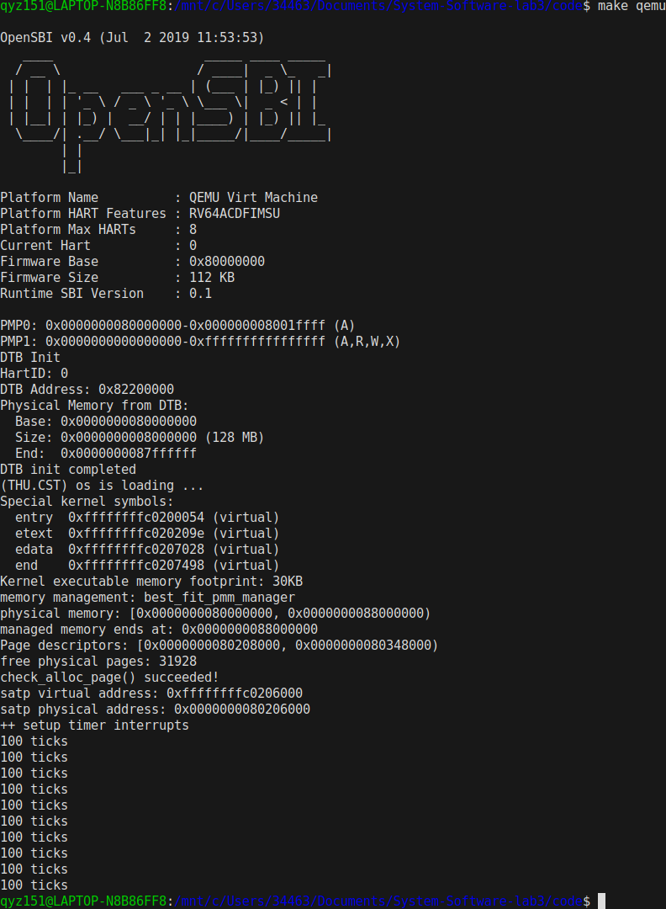
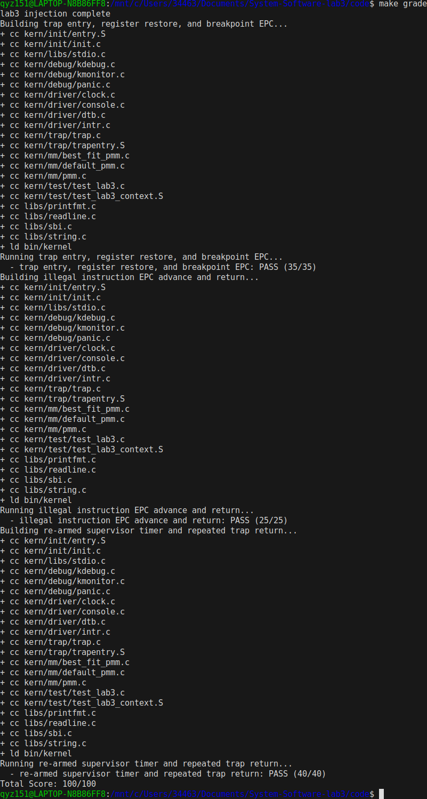
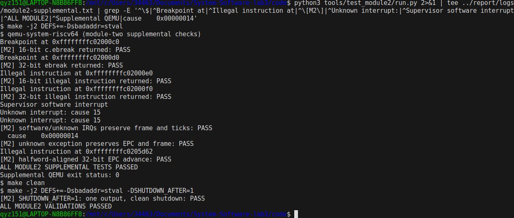

# 实验报告

## 实验基本信息

| 项目 | 内容 |
|------|------|
| **实验名称** | Lab 4：进程管理 |
| **小组成员** | 2511107-林永盛、2511592-陈逍宇、2513411-邱宇湛 |
| **完成日期** | 2026-11-19 |

### 小组分工

练习如何分工？

| 成员 | 负责的练习/模块 |
|------|----------------|
| 2511107-林永盛 | [功能模块三] |
| 2511592-陈逍宇 | [功能模块一] |
| 2513411-邱宇湛 | [功能模块二] |

实验报告如何分工？
| 成员 | 负责的部分 |
|------|----------------|
| 2511107-林永盛 | [一、实验目的 二、实验环境 三、实验整体逻辑分析 四、实验内容与实现 五、测试与验证] |
| 2511592-陈逍宇 | [一、实验目的 四、实验内容与实现] |
| 2513411-邱宇湛 | [四、实验内容与实现 五、测试与验证] |

---

## 一、实验目的

本实验的总体目的是在 RISC-V 架构上实现并理解 uCore 内核线程从创建到首次运行的完整过程，掌握页表管理、线程创建、中断控制和上下文切换如何配合，使 CPU 能够从启动时的 `idleproc` 切换到新建的 `initproc`。具体目标包括：

1. **掌握页映射的建立、更新和撤销。** 通过实现 `page_insert()` 和 `page_remove()`，理解页表项、物理页引用计数与 TLB 之间的关系，掌握同页权限更新、异页替换、重复删除和分配失败回滚的处理方法。
2. **理解内核线程的创建与首次运行。** 通过初始化进程控制块、分配内核栈、登记 PID 和构造初始执行现场，理解 `idleproc` 如何复用启动现场，以及新建的 `initproc` 如何借助 `context` 和 `trapframe`，从第一次被调度进入 `init_main()`。
3. **掌握线程调度与上下文切换。** 通过实现 `schedule()`、`proc_run()` 和 `switch_to()`，理解内核如何选择可运行线程、按需切换页表、保存和恢复寄存器。结合 `local_intr_save()` 和 `local_intr_restore()`，理解调度临界区为何需要暂时关闭本地中断，以及嵌套调用为何必须恢复进入前的中断状态。
4. **理解多级页表的共性与接口设计。** 对比 Sv32、Sv39 和 Sv48 的页表层数与索引方式，解释 `get_pte()` 为什么在不同层级重复相似的查表步骤，并从代码复用、查询副作用和失败回滚三个角度，分析将页表查找与页表页分配合并或拆分的取舍。

---

## 二、实验环境

你们使用的 AI 工具

| 成员 | AI 编程工具 | 底层模型 | 备注 |
|------|------------|---------|------|
| 2511107-林永盛 | Codex（终端 Agent） | GPT-6.1 Sol | 高 |
| 2511592-陈逍宇 | Codex (Vs Code插件) | GPT-6.2 Astra | 中 |
| 2513411-邱宇湛 | Codex（终端 Agent） | GPT-6.1 Sol | 高 |

**说明：**
- **AI 编程工具**：指具体使用的终端工具、编辑器插件、桌面应用或浏览器界面
- **底层模型**：指该工具使用的大语言模型及版本

---

## 三、实验整体逻辑分析

### 3.1 本章节的逻辑主线

本章围绕“发生中断或异常后，内核如何接管执行并正确返回”展开。在前面实验能够启动内核和管理物理内存的基础上，本实验补上 Trap 的上下文管理和具体事件处理，使内核能够响应突发事件，而不是只按原来的指令顺序一直运行。

整个过程分为硬件记录、汇编保存恢复和 C 语言处理三个环节。硬件先记录 Trap 原因、返回位置和相关状态，并进入 `stvec` 指定的入口；`trapentry.S` 再把通用寄存器和相关 CSR 快照保存在当前栈上；`trap.c` 根据原因分发到中断或异常处理函数。处理结束后，从同一份 Trap frame 恢复状态，通过 `sret` 返回。

主要执行关系为：

```text
kern_init() 完成启动准备，idt_init() 设置 Trap 入口
    ↓
clock_init() 设置首次时钟事件，intr_enable() 开启中断
    ↓
发生交给 S 模式处理的中断或异常
    ↓
硬件记录返回位置、原因和状态，跳到 __alltraps
    ↓
SAVE_ALL：保存现场，sp 指向当前 Trap frame
    ↓
通过 a0 传递帧地址，调用 trap(tf)
    ↓
trap_dispatch(tf) 判断类型
    ├─ interrupt_handler(tf)：处理中断
    │      └─ 时钟事件重设、计数、周期输出及规定条件下关机
    └─ exception_handler(tf)：处理异常
           └─ 非法指令、断点及兜底处理，按要求更新 epc
    ↓
处理函数返回，继续进入 __trapret
    ↓
RESTORE_ALL 恢复现场，sret 返回指定执行位置
```

时钟中断是异步事件，处理后通常继续执行被打断的代码；非法指令和断点是当前指令引起的同步异常，按本实验要求处理后要调整 `epc`，避免再次执行同一条异常指令。两者共用入口和现场管理机制，但具体处理行为不同。

### 3.2 功能的逐步实现

**1. 复用内存管理基础，准备 Trap 处理入口。**

将 Lab2 完成的物理内存初始化和 Best-Fit 实现迁入对应位置，保留 Lab3 新增的中断保护包装。`idt_init()` 设置 `sscratch` 的初始状态，并将 `__alltraps` 的地址写入 `stvec`。这里虽然沿用 IDT 的命名，实际是配置 RISC-V 的统一 Trap 入口，不是建立 x86 的中断描述符表。

**2. 按已有保存关系实现上下文恢复。**

先核对 `SAVE_ALL` 与 `struct trapframe`，确认 RV64 下帧大小为 288 字节，旧 `sp` 位于第 2 号槽位。恢复时取出帧内的返回状态，恢复通用寄存器，最后恢复 `sp`，保证整个读取过程中帧基址有效。这个环节是处理结束后能够继续运行的基础。

**3. 建立汇编入口与 C 函数之间的调用关系。**

保存完成后，通过 `a0` 将当前帧地址传给 `trap(struct trapframe *tf)`。C 函数访问的是汇编已经保存的同一份上下文，不是再建立一个副本。C 返回时保持调用前的栈指针，使程序能够继续进入 `__trapret`。

**4. 完成中断和异常的具体处理。**

`trap_dispatch()` 根据原因区分中断和异常。时钟中断每次都设置下一次事件，并维护 `ticks`、按规定输出统计信息和关机；非法指令和断点异常输出相应信息，结合实际指令长度调整 `tf->epc`。未要求恢复的其他异常通过输出 Trap frame 辅助诊断。这样既能识别事件，也能与后续返回路径衔接。

**5. 将上下文管理与事件处理集成验证。**

上下文恢复决定寄存器和执行位置能否正确恢复，具体处理函数决定事件如何处理以及是否需要改变返回位置，两者必须一起配合。验证时先检查编译和各模块行为，再通过 `make qemu` 观察内核输出，通过 `make grade` 检查课程用例；编译运行和评分截图统一放在第五部分。

---

## 四、实验内容与实现

### 功能模块一：虚拟内存页操作功能

**负责人：2511592-陈逍宇** 

#### 模块功能描述

**需要实现/修改的汇编接口：**

```c
int page_insert(pde_t *pgdir, struct Page *page, uintptr_t la, uint32_t perm);(kern/mm/pmm.c)
void page_remove(pde_t *pgdir, uintptr_t la);(kern/mm/pmm.c)
```

**与之衔接的已有接口：**

```c
get_pte()、pte_create()、pte2page()、page_ref_inc()、page_ref_dec()、set_page_ref()、alloc_page()、free_page()、tlb_invalidate()、flush_tlb()   
pde_t、pte_t、struct Page、pages、boot_pgdir_va  
PTE_V、PTE_U、PTE_W、PTE_R
```

**功能说明：**

这个模块负责在现有多级页表框架上完成最基本的映射维护，也就是把物理页挂到指定线性地址上，以及把已有映射安全地撤销掉。

#### 关键状态和实现步骤
##### 关键状态

`page_insert()` 和 `page_remove()` 都会改变线性地址 `la` 的映射。实现时需要同时维护三项状态。

| 状态 | 在代码中的含义 | 更新要求 |
|---|---|---|
| 末级页表项 `*ptep` | `PTE_V` 表示该项有效，物理页号和权限位决定 `la` 指向哪一页、允许怎样访问 | 建立或替换映射时写入新页号和权限，删除时清零 |
| 物理页引用计数 `page_ref(page)` | 记录物理页持有的引用；每个有效映射贡献一个引用 | 新增映射加一，撤销映射减一。同一地址重新映射到同一页时计数不变 |
| TLB 中缓存的地址翻译 | CPU 可能仍缓存 `la` 对应的旧物理页或旧权限 | 先更新页表项，再使对应翻译失效，最后才允许回收旧页 |

##### `page_insert()` 的实现步骤

1. **取得末级页表项。** 先保存 `pgdir[PDX1(la)]` 的原值，再调用 `get_pte(pgdir, la, 1)`。参数 `1` 允许创建缺失的中间页表。若第一次分配成功、第二次失败，根表项已经发生变化，因此要恢复原值、刷新 TLB 并回收刚分配的页表页，然后返回 `-E_NO_MEM`。此时目标物理页的引用计数仍保持原值。
2. **判断原映射。** 若 `*ptep` 带有 `PTE_V`，用 `pte2page(*ptep)` 记下旧页 `old`；否则令 `old = NULL`。当 `old != page` 时，调用 `page_ref_inc(page)` 为新映射增加一个引用。若 `old == page`，说明此次操作只需更新权限。
3. **写入映射并刷新翻译。** 执行 `*ptep = pte_create(page2ppn(page), perm)`，用目标页号和本次传入的权限重新构造页表项。随后调用 `tlb_invalidate(pgdir, la)`。即使物理页相同，这一步仍然重要，例如撤销写权限后，CPU 需要丢弃缓存的旧权限。
4. **释放旧引用。** 若 `old` 存在且与 `page` 不同，调用 `page_ref_dec(old)`；计数降到零时才调用 `free_page(old)`。完成后返回 `0`。将回收放在最后，可以保证旧物理页重新进入分配器前，旧映射已经撤销。

##### `page_remove()` 的实现步骤

1. **只查询现有映射。** 调用 `get_page(pgdir, la, &ptep)`，同时取得物理页和末级页表项。其内部使用 `get_pte(pgdir, la, 0)`，查询过程不会分配页表。若中间页表缺失或末级页表项无效，直接返回。
2. **撤销映射。** 将 `*ptep` 清零，再调用 `tlb_invalidate(pgdir, la)`，使 CPU 丢弃该地址的旧翻译。
3. **减少物理页引用。** 调用 `page_ref_dec(page)`，仅在结果为零时释放物理页。因此，若两个地址都映射到 `p1`，删除第一个地址只会让计数从 `2` 降到 `1`，另一个地址仍能访问 `p1`；再次删除第一个地址时，查询已经找不到有效映射，计数仍为 `1`。这也就是删除操作的幂等性。
##### 最终提示词

以下是经过迭代优化后，最终成功实现该功能的提示词：

````markdown
## [PROMPT]

**任务**：在 `code/kern/mm/pmm.c` 的 `//LAB4 function1 YOUR CODE` 标记处，补全 `page_insert` 和 `page_remove`。两个函数共同维护 `la` 所在虚拟页的映射，使叶子页表项、物理页引用计数和 TLB 状态在操作完成后保持一致。

**操作要求**：直接修改项目中的实际文件。保留标记和既有逻辑，仅在标记对应的两个函数内进行必要修改。函数签名须与 `code/kern/mm/pmm.h` 中的声明一致。

**输出要求**：依据以下上下文和行为规格完成修改，以工程中的真实定义为准。完成后简要说明验证结果，区分已运行的测试和仅通过代码检查的情形。

## [RELY]

- `get_pte(pgdir, la, create)` 定位 `la` 对应的叶子页表项。`create` 为 `0` 时仅查找，为 `1` 时允许分配缺少的中间级页表页。返回非空指针表示叶子槽位存在，槽位内容含 `PTE_V` 才表示已有有效映射。
- 当前工程使用三级页表。`get_pte(pgdir, la, 1)` 可能在第一个中间级页表页已经分配并挂接后，因第二次分配失败而返回 `NULL`。`PDX1(la)` 可定位根表项，`pde2page()` 可取得有效中间级表项指向的页表页。
- `page2ppn(page)` 返回物理页号。`pte_create(ppn, type)` 使用物理页号和标志构造页表项，并自动置 `PTE_V`。`pte2page()` 可从有效叶子项取得 `struct Page *`。`PTE_U`、`PTE_R`、`PTE_W` 等权限位沿用工程定义。
- `get_page(pgdir, la, &ptep)` 仅查找已有映射。它返回映射的物理页，同时通过 `ptep` 提供叶子槽位指针。缺少中间级页表或叶子项无效时，返回 `NULL`。
- `page_ref_inc()` 和 `page_ref_dec()` 均返回更新后的引用计数。`free_page()` 回收一个物理页。`tlb_invalidate(pgdir, la)` 使指定地址的翻译失效，`flush_tlb()` 提供整体失效操作。

## [GUARANTEE]

交付以下两个现有接口，无需新增辅助函数或公开接口。

```c
int page_insert(pde_t *pgdir, struct Page *page, uintptr_t la, uint32_t perm);
void page_remove(pde_t *pgdir, uintptr_t la);
```

## [SPECIFICATION]

### `page_insert`

**Pre-Condition**：`pgdir` 指向有效页表根，`page` 指向已分配、可建立映射的受管物理页，`perm` 为调用者要求的页表标志。`la` 可以带有页内偏移，操作对象是其所在的虚拟页。

**Post-Condition**：成功返回 `0`。目标叶子项有效，指向 `page`，权限按本次 `perm` 设置；相关物理页的引用计数反映映射的实际增减。内存不足时返回 `-E_NO_MEM`，原有映射、引用计数和空闲页数量保持调用前的状态。

- **Case 1 · 原地址未映射**：建立映射，目标物理页的引用计数增加一次。若同一物理页已映射到其他地址，那些映射继续有效。
- **Case 2 · 原地址已映射到 `page`**：更新权限，清除旧映射中本次未请求的权限位。该物理页的引用计数保持不变，包括它仅有这一个引用的情形。
- **Case 3 · 原地址已映射到另一物理页**：将映射替换为目标页及本次权限。目标页增加一个引用，旧页减少一个引用。旧页引用归零时回收，仍有引用时保留。
- **Case 4 · 中间级页表分配失败**：撤销本次调用已经挂接的临时页表，归还对应页表页，保留调用前已存在的页表结构。目标地址不留下半完成映射，目标物理页不增加引用。

**Requirements**：新叶子项写入后，使 `la` 对应的 TLB 条目失效，包括仅更新同页权限的情形。若旧物理页需要回收，应先使旧翻译失效，再让物理页进入空闲集合。失败回滚涉及已挂接的中间级页表时，同样应在回收该页表页前完成必要的失效处理。

### `page_remove`

**Pre-Condition**：`pgdir` 指向有效页表根。`la` 可以带有页内偏移，其所在虚拟页可以已映射，也可以未映射。

**Post-Condition**：返回后，`la` 所在虚拟页无有效映射。其他虚拟页的映射保持原状。对同一地址重复调用不会重复减少引用或回收页面。

- **Case 1 · 存在有效映射**：清空目标叶子项，使该地址的 TLB 条目失效，并将原物理页的引用计数减少一次。计数归零时回收物理页，仍有引用时保留。已有中间级页表继续保留。
- **Case 2 · 不存在有效映射**：无论缺少中间级页表，还是已有叶子槽位但其有效位未置位，均直接返回。查找过程不分配页表页，不改变任何引用计数，也不回收页面。
````

#### 迭代过程

这两个函数的实现经历了三个阶段：先理清映射与引用计数的关系，再处理分配失败和重复删除等边界情况，最后从单独测试推进到完整内核验证。

1. **确定建立、替换和删除映射的规则。** `page_insert()` 先通过 `get_pte(pgdir, la, 1)` 定位末级页表项，再根据旧映射决定如何更新引用计数。原地址未映射时，目标页引用加一；原地址指向另一物理页时，新页引用加一，旧页引用减一；原地址已经指向目标页时，只更新权限，引用计数保持不变。`page_remove()` 则通过 `get_page()` 查询现有映射，只有找到有效映射才清除页表项并减少引用。

2. **补齐失败回滚，并确定旧页的回收时机。** 检查 `get_pte()` 的实现时发现，Sv39 页表遍历可能连续分配两张中间页表页。如果第一张分配成功、第二张失败，仅返回 `-E_NO_MEM` 会留下刚挂到根表上的空页表。因此 `page_insert()` 在调用前保存原根表项，必要时恢复它并回收新分配的页表页。对于成功的替换和删除，两个函数都先更新页表项，再使对应的 TLB 翻译失效，最后才释放引用计数归零的旧页。这样也保证了重复调用 `page_remove()` 时不会再次扣减引用。

3. **先单独验证，再验证完整启动路径。** 最初 Lab2、Lab3 的前置代码尚未补齐，因此先对 `pmm.c` 做 RISC-V 交叉编译，再用宿主模拟测试运行课程 PMM 断言，并额外验证两处分配失败时的回滚。补齐前置代码后，又在 QEMU 中运行完整内核，验证真实页表下的映射访问。`check_boot_pgdir()` 将同一物理页映射到两个虚拟地址，通过其中一个地址写入字符串，再从另一个地址读出相同内容。

#### 最终结果

`page_insert()` 能正确完成首次映射、同页权限更新和异页替换，成功返回 `0`，中间页表分配失败时回滚并返回 `-E_NO_MEM`。`page_remove()` 能安全撤销映射，保留仍被其他地址引用的物理页，对已删除或从未映射的地址可重复调用。

完整内核在 QEMU 中输出了 `check_pgdir() succeeded!` 和 `check_boot_pgdir() succeeded!`。课程评分中的 **PMM 项通过，获得 10/10**；包含进程创建和调度在内的 Lab4 总分为 **30/30**。   

---
### 功能模块二：中断与异常处理功能

**负责人：** 

#### 模块功能描述

**需要实现的 C 语言接口：**

```c
// kern/trap/trap.c
void interrupt_handler(struct trapframe *tf);
void exception_handler(struct trapframe *tf);
```

**与之衔接的已有接口和状态：**

```c
void print_trapframe(struct trapframe *tf);
void clock_set_next_event(void);
extern volatile size_t ticks;
void sbi_shutdown(void);
#define TICK_NUM 100
static void print_ticks();
```

**功能说明：**

模块一负责把现场交给 `trap()` 并在处理结束后恢复执行，本模块决定“本次 Trap 应该如何处理”。已有 `trap_dispatch()` 根据 `cause` 最高位分发：最高位为 1 时调用 `interrupt_handler()`，否则调用 `exception_handler()`。两个函数使用同一份 Trap frame，处理结束后回到已有的统一返回路径。

时钟中断需要预约下一次事件、增加计数、周期输出，并在累计输出达到规定次数后关机；其他已知中断输出类别提示，未知中断输出原因编号和完整 Trap frame。非法指令和断点异常需要输出发生地址并推进 `epc`，避免返回后重复触发；其他异常保留现场并打印，作为诊断兜底。

#### 关键状态和实现步骤

**1. 区分中断类型位与原因编号**

RV64 的 `cause` 最高位是中断标志，不能直接把带标志的完整值与 `IRQ_S_TIMER` 等编号比较。本实现只在局部变量中清除该位：

```c
uintptr_t cause = tf->cause &
    ~((uintptr_t)1 << (sizeof(uintptr_t) * 8 - 1));
```

使用掩码不会改变 `tf->cause`，也兼容课程测试直接传入没有最高位标志的 `15`。如果使用异或去位，未置位输入会被错误地加上最高位；本次直接调用测试同时检查 `15` 和带最高位的 `15`，两者均输出 `Unknown interrupt: cause 15`。

**2. S 模式时钟中断：重设事件、计数、输出和关机**

时钟分支的核心实现为：

```c
case IRQ_S_TIMER:
    clock_set_next_event();
    ticks++;
    if (ticks % TICK_NUM == 0) {
        print_ticks();
        if (ticks / TICK_NUM >= SHUTDOWN_AFTER) {
            sbi_shutdown();
        }
    }
    break;
```

`clock_init()` 只预约第一次时钟事件。SBI 的定时接口每次设置一个目标时刻，因此每次中断都必须调用 `clock_set_next_event()`；只增加 `ticks` 会使后续时钟事件无法持续发生。`ticks` 在 `clock.c` 中声明为 `volatile size_t`，每次 S 时钟中断恰好加 1。

`TICK_NUM` 是每次统计间隔，`SHUTDOWN_AFTER` 是累计输出次数，两者含义不同。框架未提供后者，本模块在填空区域使用 `#ifndef SHUTDOWN_AFTER` 定义默认值 10，允许通过编译参数覆盖。默认状态变化为：

| 增加后的 ticks | 本次统计输出 | 累计输出次数 | 是否调用关机接口 |
|----------------|--------------|--------------|------------------|
| 1～99 | 无 | 0 | 否 |
| 100 | `100 ticks` | 1 | 否 |
| 200 | `100 ticks` | 2 | 否，课程持续时钟用例可完成 |
| 1000 | `100 ticks` | 10 | 是 |

输出复用已有 `print_ticks()`，没有改成累计数值，也没有改变其 `DEBUG_GRADE` 条件行为。默认运行实测恰好输出 10 行后退出；临时副本用 `-DSHUTDOWN_AFTER=1` 构建时，恰好输出一行后关机。时钟计数为后续调度提供基础，本模块没有实现进程调度。

**3. 其他中断与未知中断的处理**

其余分支按 `riscv.h` 中现有的软件、定时器、外部、协处理器和主机中断常量输出类别提示。例如 S 软件中断输出 `Supervisor software interrupt`。这些分支不更新 `ticks` 或 `epc`。头文件中的类别名称属于框架接口，分类输出本身不表示已实现相应硬件驱动、清除设备中断源或所有来源的实际委托。

无法识别的编号先输出 `Unknown interrupt: cause N`，再调用 `print_trapframe(tf)`。清除类型位只影响局部编号，诊断仍使用原始帧。中断处理函数没有修改保存的任何寄存器或返回地址，因此异步中断结束后继续被打断的执行流。

**4. 非法指令和断点：先输出原地址，再按指令长度推进 epc**

`exception_handler()` 根据原始异常原因分类：

| 异常原因 | 输出内容 | 返回位置处理 |
|----------|----------|--------------|
| `CAUSE_ILLEGAL_INSTRUCTION` | `Illegal instruction at 0x...` | 按该指令的 2/4 字节长度推进 |
| `CAUSE_BREAKPOINT` | `Breakpoint at 0x...` | 按该指令的 2/4 字节长度推进 |
| 其他异常 | `print_trapframe(tf)` | 保留原 epc，直接返回 |

地址输出使用 `%p`，保留 RV64 地址宽度。两个要求跳过的分支共用以下长度判断：

```c
uint16_t instruction = *(const uint16_t *)tf->epc;
tf->epc += (instruction & 0x3) == 0x3 ? 4 : 2;
```

RISC-V 的 16 位压缩指令低两位不为 `11`；在本实验要求处理的 16/32 位集合内，低两位为 `11` 对应 32 位指令。因此不能把所有异常固定推进 4 字节，也不能简单规定“断点加 2、非法指令加 4”。`c.ebreak` 为 2 字节，`ebreak` 为 4 字节，两种长度的非法指令也分别需要处理。

这里只读取首个 16 位半字，允许指令位于仅按 2 字节对齐的地址。前提是已知异常的 `epc` 可读取，且待跳过的指令为 16 或 32 位；本模块没有实现 48 位及更长指令解码。其他异常分支在读取指令之前就返回，不会擅自解引用可能无效的地址。兜底打印也没有解决原异常，返回到未修复的指令仍可能再次触发 Trap。

**5. 与统一返回机制配合**

两个函数均不直接写硬件 `sepc`，也不执行 `sret`。异常分支修改的是帧中的 `tf->epc`，随后模块一的 `RESTORE_ALL` 将其恢复到 `sepc`；中断分支保留 `epc`。其余通用寄存器和状态字段保持不变，使“事件处理决定返回位置，统一恢复路径执行返回”的职责关系一致。

代码保留 `lab3 function2` 注释，将 `YOUR CODE` 替换为 `2511592 2513411`；新增头文件和宏也位于该标记区域。已有 `print_ticks()`、`trap_dispatch()`、`trap()`、模块一汇编和教师测试逻辑均保持原有内容。

#### Spec 与 Prompt 的设计思路

我们以[实验要求](http://oslab.mobisys.top/lab2026/_book/lab3/lab3_2_1_exercise.html)为依据，按四段式组织提示词。[PROMPT] 明确目标文件、两个函数、学号标记和修改范围；[RELY] 列出真实的 Trap frame、时钟和 SBI 接口、原因常量及指令长度约束；[GUARANTEE] 固定公开接口和交付行为；[SPECIFICATION] 则把状态变化拆成可以验证的条件。

| 规格部分 | interrupt_handler | exception_handler |
|----------|-------------------|-------------------|
| Pre-Condition | 有效帧，时钟已初始化，计数未溢出，输出间隔和关机阈值有效 | 有效帧；已知异常的指令半字可读取，待跳过指令为 16/32 位 |
| Post-Condition | 保留帧；只有 S 时钟分支更新 ticks | 已知异常仅更新 epc，其他异常保留全帧 |
| Case | S 时钟；其他已知中断；未知中断 | 非法指令；断点；其他异常 |
| Requirements | 每次重设事件，每次加 1，按输出次数关机，正确清除类型位 | 根据编码判断长度，先输出原地址，不对未知异常统一跳过 |

#### 最终提示词

以下为结合本次实现和实际验证整理的最终提示词，与 `prompt.md` 的模块二内容一致：

````markdown
[PROMPT]

**任务**：在当前 uCore Lab3 工程中，修改 `code/kern/trap/trap.c`，完成“功能模块二：中断与异常处理功能”，实现 `interrupt_handler(struct trapframe *tf)` 和 `exception_handler(struct trapframe *tf)`，使其与已有的 Trap 分发、上下文恢复和 `sret` 返回流程配合。

**操作要求**：必须修改项目中的实际文件。新增生产代码限定在 `lab3 function2 YOUR CODE` 标记区域，保留 `lab3 function2` 注释，并将 `YOUR CODE` 替换为 `2511592 2513411`。可以在该区域引入 `sbi.h`、定义本模块需要的宏。不得修改 `print_ticks()`、`trap_dispatch()`、`trap()`、`SAVE_ALL`、`RESTORE_ALL`、Trap frame 布局或教师测试；不得实现 Challenge，不提交或推送 Git。

**输出要求**：依据下面的真实依赖和行为规格实现，说明原因编号提取、下一次时钟事件设置、异常指令长度判断和返回地址更新的依据。实际执行构建、QEMU 启动及原课程评分，记录命令、结果和环境问题。补充验证应使用临时工程副本，不把测试入口写入正式启动流程；保留真实日志，截图应注明取材方式。

[RELY]

1. 先读取工程中的 `trap.c`、`trap.h`、`libs/riscv.h`、`libs/defs.h`、`kern/driver/clock.h`、`kern/driver/clock.c`、`libs/sbi.h`、`tools/grade.sh` 和 `tools/test_lab3.c`，以实际定义为准。

2. 当前目标为 RV64，`uintptr_t` 为 64 位。已有上下文结构如下：

```c
struct trapframe {
    struct pushregs gpr;
    uintptr_t status;
    uintptr_t epc;
    uintptr_t badvaddr;
    uintptr_t cause;
};
```

`cause` 最高位表示中断，其余位为原因编号；同步异常的最高位为 0。已有 `trap_dispatch()` 通过 `(intptr_t)tf->cause < 0` 分发。两个处理函数只处理 C 层行为，由模块一从同一份帧恢复现场并执行 `sret`。

3. 已有接口和状态：

```c
void print_trapframe(struct trapframe *tf);
void clock_set_next_event(void);
extern volatile size_t ticks;
void sbi_shutdown(void);
#define TICK_NUM 100
static void print_ticks();
```

`clock_init()` 将 `ticks` 初始化为 0，并预约第一次时钟事件；`clock_set_next_event()` 通过 SBI 设置下一次事件。`print_ticks()` 已在同一文件实现，普通构建每次输出一行 `100 ticks`；保留其原有 `DEBUG_GRADE` 条件行为。

4. 工程提供 `IRQ_U/S/H/M_SOFT`、`IRQ_U/S/H/M_TIMER`、`IRQ_U/S/H/M_EXT`，以及 `IRQ_COP`、`IRQ_HOST` 常量。它们表示现有头文件列出的原因编号；按这些符号分类输出，不据此声称所有来源都能实际委托到当前 S 模式内核。

5. 异常原因使用 `CAUSE_ILLEGAL_INSTRUCTION` 和 `CAUSE_BREAKPOINT`。本实验要求恢复的指令限定为 16 位和 32 位；读取 `epc` 处的首个 16 位半字，低两位不等于 `11` 时长度为 2 字节，在本实验的指令集合中低两位等于 `11` 时长度为 4 字节。不扩展为对 48 位及更长指令的通用处理。

6. 当前框架没有定义 `SHUTDOWN_AFTER`。在本模块区域中用 `#ifndef` 提供默认值 10，允许通过 `-DSHUTDOWN_AFTER=1` 等编译参数覆盖；其含义是统计输出次数，要求为正整数。默认配置第 1000 次 S 时钟中断完成第 10 次输出后关机，课程持续时钟测试需要运行到 `ticks=200`。

[GUARANTEE]

必须实现以下两个公开接口，保留名称、参数和返回类型：

```c
void interrupt_handler(struct trapframe *tf);
void exception_handler(struct trapframe *tf);
```

- `interrupt_handler()`：根据原因分类处理中断，S 时钟中断完成重设事件、计数、周期输出和达到阈值后的关机。
- `exception_handler()`：非法指令和断点输出地址并正确推进 `epc`；其他异常输出完整帧。
- 除异常分支对 `tf->epc` 的规定更新外，不修改保存的通用寄存器、`status`、`badvaddr` 和 `cause`，也不改变现有分发与返回接口。

[SPECIFICATION]

## interrupt_handler

**Pre-Condition**：
- `tf` 指向有效、可读取的 Trap frame，执行环境允许使用控制台和 SBI 接口。
- 正常调用来自 `trap_dispatch()`；直接测试也可能传入不带中断最高位的原因编号。
- 正常时钟路径中，`clock_init()` 已执行，`ticks` 为自初始化后收到的 S 时钟中断次数，测试期间不发生计数溢出。
- `TICK_NUM=100`，`SHUTDOWN_AFTER` 为正整数。

**Post-Condition**：
- 使用去除最高位后的局部原因编号进行分类，保留 `tf->cause` 原值。
- 若返回，`tf` 的全部字段保持不变；不自行改变中断的返回地址。
- 只有 `IRQ_S_TIMER` 改变 `ticks`；其他原因不会触发时钟统计或关机逻辑。

**Case 1**：`IRQ_S_TIMER`。
- 每次调用 `clock_set_next_event()` 预约下一次事件，`ticks` 恰好增加 1。
- 增加后的 `ticks` 为 `TICK_NUM` 整数倍时，调用已有 `print_ticks()`。
- 累计输出次数达到 `SHUTDOWN_AFTER` 后，调用 `sbi_shutdown()`；默认在第 10 行 `100 ticks` 输出后关机。

**Case 2**：框架列出的其他软件、定时器、外部、协处理器和主机中断。
- 输出相应类别提示；S 软件中断必须输出 `Supervisor software interrupt`。
- 这些分支只做实验要求的类别识别和提示，不增加 `ticks`，不额外实现设备应答或中断控制器驱动。

**Case 3**：未知中断。
- 输出 `Unknown interrupt: cause N`，其中 `N` 是无符号原因编号，再调用 `print_trapframe(tf)`。
- 直接传入 `15` 或带最高位的 `15` 时，均应输出原因 `15`，不能把类型位混进编号。

**Requirements**：
- 每次 S 时钟中断都重新设置下一次事件，不能只在首次或输出统计时设置。
- 原因编号的掩码与 `uintptr_t` 的宽度一致，不使用会破坏无标志直接测试输入的异或去位方式。
- 统计输出使用已有函数，保留默认配置运行到 `ticks=200` 的能力。
- 不在本函数中调用 `sret`、手工恢复寄存器或重新打开全局中断。

## exception_handler

**Pre-Condition**：
- `tf` 指向有效 Trap frame，`tf->cause` 为同步异常原因。
- 对非法指令和断点，`tf->epc` 指向可读取、至少按 2 字节对齐的指令半字；本实验待跳过的指令长度为 2 或 4 字节。
- 对其他异常，不假定 `epc` 可解引用，也不要求实现具体恢复策略。

**Post-Condition**：
- 非法指令和断点在输出原始发生地址后，将 `epc` 推进至该指令之后。
- 其他异常调用 `print_trapframe(tf)`，帧的所有字段保持不变。
- 所有分支均不修改 `cause`、`status`、`badvaddr` 或保存的通用寄存器。

**Case 1**：`CAUSE_ILLEGAL_INSTRUCTION`。输出 `Illegal instruction at 0x...`，地址为更新前的 `epc`；16 位非法指令推进 2 字节，32 位非法指令推进 4 字节。

**Case 2**：`CAUSE_BREAKPOINT`。输出 `Breakpoint at 0x...`，地址为更新前的 `epc`；16 位 `c.ebreak` 推进 2 字节，32 位 `ebreak` 推进 4 字节，使返回后继续执行后续指令。

**Case 3**：其他异常。仅调用 `print_trapframe(tf)` 后返回；不读取指令、不统一跳过，也不把诊断输出解释为异常已被修复。

**Requirements**：
- 通过首个 16 位半字的编码判断本实验中的 2/4 字节长度，不能固定 `epc += 4`，也不能仅根据异常种类猜测长度。
- 使用 16 位读取，允许 32 位指令从仅按 2 字节对齐的地址开始；不要直接依赖 32 位对齐读取。
- 地址输出保留 RV64 地址宽度，使用工程支持的 `%p` 或等效格式。
- 不直接修改硬件 `sepc`，由统一恢复路径采用帧内更新后的 `epc`。

## 验证要求

- 先完成完整构建，再运行正常 `make qemu` 和原课程 `make grade`。默认应输出 10 行 `100 ticks` 后自动关机；课程三项得分应按实际结果记录。
- 当前 GCC 14.2 汇编器不接受框架旧 CSR 名 `sbadaddr` 时，使用编译参数 `DEFS=-Dsbadaddr=stval` 做名称映射，不改模块一的保存布局。对评分子构建，应通过环境传递该参数，保留各评分宏的追加。
- Windows 检出可能使 `tools/grade.sh` 使用 CRLF；遇到 `Illegal option -` 或回车相关错误时，只转换行尾为 LF，保留教师测试内容和断言。
- 增补真实 16/32 位断点、16/32 位非法指令的 Trap 返回，以及未知原因、现场保持、仅按半字对齐的指令读取和关机阈值覆盖测试。测试在临时工程副本执行，生产启动代码不插入测试调用。
- 明确区分实际硬件 Trap、构造帧直接调用和课程测试的覆盖范围，只有实际执行成功后才写入报告。
````

#### 实现迭代过程

本次补全分为 3 轮实现与验证，记录实际问题及处理过程。


##### 第一次迭代：解决工具链与脚本行尾问题

**遇到的问题：**

- 本次 WSL Ubuntu 使用 `riscv64-unknown-elf-gcc 14.2.0` 和 `QEMU 4.1.1`。汇编器报告 `unknown CSR 'sbadaddr'`，这是框架旧 CSR 名称与当前工具链之间的兼容问题。
- 首次进入评分脚本时，Windows 检出的 CRLF 行尾导致 `tools/grade.sh: ... not found` 和 `set: Illegal option -`，评分尚未执行到用例。

**问题解决策略：**

- 使用 `DEFS=-Dsbadaddr=stval` 在编译阶段映射 CSR 名称，保留模块一汇编源码和保存布局。评分时通过环境变量传入，允许脚本继续追加各自的 `GRADE_LAB3_*` 宏。
- 将 `tools/grade.sh` 行尾转换为 LF，保持教师测试文本、用例和断言不变。复现命令统一列在第五部分。

##### 第二次迭代：补充长度、兜底与关机边界验证

**遇到的问题：**

课程评分能够验证整体衔接，但没有分别展示 16/32 位两种断点、两种非法指令，以及改变关机阈值后的行为；仅以总分无法说明这些边界已经覆盖。

**问题解决策略：**

增加 `tools/test_module2/checks.c` 和 `tools/test_module2/run.py`。脚本复制工程至临时目录，只在副本插入检查调用，链接实际的 `trap.c` 和 `trapentry.S`，正式启动流程不插入测试代码：

- 用 `.half 0x9002`、`.word 0x00100073` 触发 16/32 位断点，并确认后续代码继续执行。
- 用 `.half 0x0000`、`.word 0x0000007b` 触发 16/32 位非法指令，并确认返回。
- 构造 S 软件中断、带/不带最高位的未知中断和原因 20 的未知异常，断言 `ticks` 及完整 Trap frame 的保持关系。
- 直接调用已知异常处理函数，验证从仅按 2 字节对齐的位置读取 32 位指令时，`epc` 正确增加 4。
- 再用 `SHUTDOWN_AFTER=1` 构建普通启动副本，确认只输出一次统计后正常退出。

上述检查均通过。后几项构造帧测试验证的是处理函数行为，不代表实际产生了对应设备中断或未知异常；真实指令触发的四项测试则经过了生产 Trap 入口和返回路径。

**最终结果：**

- 本次于 **2026-11-05** 完成验证；完整工程构建通过。
- 正常 `make qemu` 输出 10 行 `100 ticks` 后自动关机，退出状态为 0。
- 原课程评分为 **35/35、25/25、40/40，总分 100/100**。
- 补充验证全部通过，日志输出 `ALL MODULE2 VALIDATIONS PASSED`。
- 实际日志、截图及复现方式见第五部分。覆盖范围为本实验的 S 时钟处理、16/32 位异常跳过和规定兜底行为，不包含通用异常恢复、完整设备驱动或进程调度。

---

## 五、测试与验证

本节为 2026-11-05 在 WSL Ubuntu 上对当前工程的实际验证。工具链为 `riscv64-unknown-elf-gcc 14.2.0`，模拟器为 `QEMU 4.1.1`。

在 WSL 中进入本仓库的 `code/`，依次执行：

```bash
# Windows 检出使用 CRLF 时，仅将评分脚本行尾转换为 LF。
sed -i 's/\r$//' tools/grade.sh

# 环境变量保留 CSR 名称映射，各课程用例可继续追加自己的评分宏。
env DEFS=-Dsbadaddr=stval make grade

# 评分后重新构建普通内核，避免沿用评分配置。
env DEFS=-Dsbadaddr=stval make -j2
env DEFS=-Dsbadaddr=stval timeout 20s make qemu

# 补充测试在临时工程副本运行，不修改正式启动流程。
python3 tools/test_module2/run.py
```

### 1. 编译及内核运行（make qemu）

**测试截图：**



图 1：本次完整构建生成 `bin/kernel` 和 `bin/ucore.img`。正常内核启动、物理内存自检通过，时钟初始化后连续输出 10 行 `100 ticks`，达到默认累计输出阈值后自动关机，`make qemu` 退出状态为 0。`timeout` 只用于限制异常运行时长，本次未因超时退出。


### 2. 课程测试结果（make grade）

**测试截图：**



图 2：原课程脚本的三项测试全部通过，总分 **100/100**，命令退出状态为 0。截图保留该次终端运行中的编译和评分输出，完整日志中也保留各次构建输出。

| 课程测试 | 实际结果 | 验证重点 |
|----------|----------|----------|
| Trap 入口、寄存器恢复和断点返回 | 35/35 | 模块一与模块二的调用、现场恢复及断点 epc 更新能够衔接 |
| 非法指令返回及兜底输出 | 25/25 | 非法指令跳过、S 软件中断提示、未知中断编号及未知异常帧输出 |
| 重设时钟和反复 Trap 返回 | 40/40 | 时钟持续触发到 `ticks=200`，输出统计后仍能继续执行 |

完整日志：[module2-grade.txt](./logs/module2-grade.txt)。

### 3. 模块二补充验证

**测试截图：**



图 3：`python3 tools/test_module2/run.py` 的补充验证全部通过。脚本在临时副本链接真实处理函数和 Trap 汇编，先执行异常与状态保持检查，再单独构建关机阈值为 1 的普通内核。

| 测试场景 | 验证方式 | 实际结果 |
|----------|----------|----------|
| 16 位 `c.ebreak` 与 32 位 `ebreak` | 执行真实指令，经 Trap 入口和 `sret` 返回后打印 PASS | 两项均通过 |
| 16 位 `0x0000` 与 32 位 `0x0000007b` 非法指令 | 执行真实指令，返回后继续执行 | 两项均通过 |
| S 软件中断、未知原因 15（带/不带最高位） | 构造帧直接调用，比较完整帧及 ticks | 提示正确，原现场和计数均不变 |
| 原因 20 的未知异常 | 构造帧直接调用，比较完整帧 | 打印 `cause 0x00000014`，不推进 epc |
| 仅按 2 字节对齐的 32 位指令 | 读取首个半字，直接验证 epc 和其他字段 | epc 增加 4，其余字段不变 |
| `SHUTDOWN_AFTER=1` | 临时副本重新构建并正常启动 | 恰好一行 `100 ticks`，QEMU 正常退出 |


---

## 六、实验总结与收获

### 对操作系统的理解

**1. 本实验的重要知识点及其与 OS 原理的对应关系**

| 知识点 | OS 原理中的含义 | 本实验中的对应实现及区别 |
|--------|-----------------|--------------------------|
| 中断与异常 | 中断通常由外部事件异步触发，异常由当前指令同步引起；二者都能使处理器转入系统的处理流程。 | 二者共用 `__alltraps` 和 `trap()`，再根据 `cause` 分发。时钟中断和非法指令、断点异常具有不同的处理与返回要求，不能统一理解为跳过一条指令。 |
| 特权级与 Trap 入口 | 操作系统通过受控入口处理低权限软件或硬件事件，权限转换受体系结构规则约束。 | OpenSBI 运行在 M 模式，内核运行在 S 模式；对委托给 S 模式的 Trap，CPU 使用 `stvec` 指定的入口。发生 Trap 不一定改变权限级，S 模式也可以进入 S 模式处理程序。 |
| 上下文与 Trap frame | 上下文是继续执行所需的处理器状态，现场保存使事件处理不会无故破坏原程序。 | `SAVE_ALL` 将通用寄存器和 CSR 快照写入栈上的 `struct trapframe`，`RESTORE_ALL` 按对应布局恢复。Trap frame 是一次 Trap 的现场记录，不是 PCB，也不代表已经切换进程。 |
| 硬件与软件的分工 | 硬件负责必要的 Trap 入口状态更新，操作系统负责进一步保存现场和执行处理策略。 | 硬件记录 `sepc`、`scause` 并更新相关状态，汇编再保存通用寄存器和 CSR 快照。不是硬件自动将全部寄存器压栈，也不是保存两份完整上下文。 |
| ABI 与汇编调用 C | ABI 规定函数参数、返回地址、寄存器保存责任和栈对齐，保证不同代码正确调用。 | `__alltraps` 用 `a0` 传递帧地址，调用 `trap()`。普通函数调用约定不能替代任意位置发生 Trap 时的现场保存，但进入 C 函数时仍要遵守 ABI。 |
| 异常恢复与返回位置 | 异常处理必须决定重试、跳过或终止等策略，不同异常不能采用同一种恢复方式。 | 本实验对非法指令和断点按要求更新帧内 `epc`，恢复代码使用更新后的值；`sret` 根据返回状态恢复执行，不等同于普通 `ret`。其他异常的兜底打印也不代表已经具备通用恢复能力。 |
| 时钟中断与周期事件 | 操作系统利用定时事件维护时间和执行周期工作，调度是其可能支持的上层功能。 | OpenSBI 的定时器接口设置目标时刻，每次时钟中断中重新预约下一次事件，更新计数并定期输出。本实验处理时钟事件，没有实现进程轮转调度。 |
| 临界区与原子性 | 相互关联的数据修改需要避免其他执行流观察到不一致的中间状态。 | 物理页分配接口保存原中断状态、关闭中断并在结束后恢复。它保护当前 CPU 上相应中断造成的干扰，不等于多核互斥，也不表示同步异常不会发生。 |

**2. OS 原理中重要，但本实验没有对应实现的知识点**

- **完整进程管理与调度。** 本实验没有建立进程 PCB、就绪队列和时间片轮转算法，也没有实现不同进程之间的上下文切换。
- **用户进程和系统调用。** 完整系统还需要用户地址空间、用户栈与内核栈切换、系统调用分发和参数检查。本次必做内容基于现有可用内核栈，没有完成这些用户进程机制。
- **按需分页和页面置换。** 本实验复用物理内存及启动映射基础，没有实现缺页分配、页面换入换出或完整的虚拟内存管理。
- **多核同步和复杂中断管理。** 多核共享数据还需要锁、原子指令和跨核协调；中断嵌套、优先级与复杂设备中断也需要进一步设计。
- **扩展寄存器现场。** 当前 Trap frame 保存整数寄存器及相关 CSR，没有覆盖浮点、向量等扩展上下文。

### AI 协作开发的经验

**首先，要把真实接口和布局整理清楚。** 我们以现有结构体、宏和保存逻辑作为 [RELY]，在 [GUARANTEE] 中列出必须完成的接口，避免 AI 自行假设字段偏移或修改框架。特别是旧 `sp` 的保存位置、帧大小、参数传递方式和函数签名，必须与工程一致。

**其次，行为规格要覆盖完整的状态变化。** 模块一关注恢复前后的寄存器、帧基址和返回状态；模块二关注原因分类、下一次时钟事件、计数以及异常处理后的 `epc`。用 Pre-Condition、Post-Condition、Case 和 Requirements 说明这些约束，比只要求“补全函数”更容易检查各模块能否配合。

**再次，要区分生成代码、依赖适配和实际验证。** Lab2 代码迁移时出现的宏名差异说明，旧实现也需要根据当前框架核对，不能直接覆盖整个文件。对生成结果既要检查编译，也要检查寄存器恢复、返回位置和持续事件处理；某一个独立测试通过不能代替整套课程测试。

**最后，团队协作需要明确修改边界和共同接口。** 模块一负责现场管理和汇编到 C 的衔接，模块二负责具体事件处理，双方通过同一份 Trap frame 连接。集成时重点核对返回状态和调用约定；报告中的问题、修正和测试结果以实际过程及终端截图为依据，不能用预期输出替代真实结果。

---

