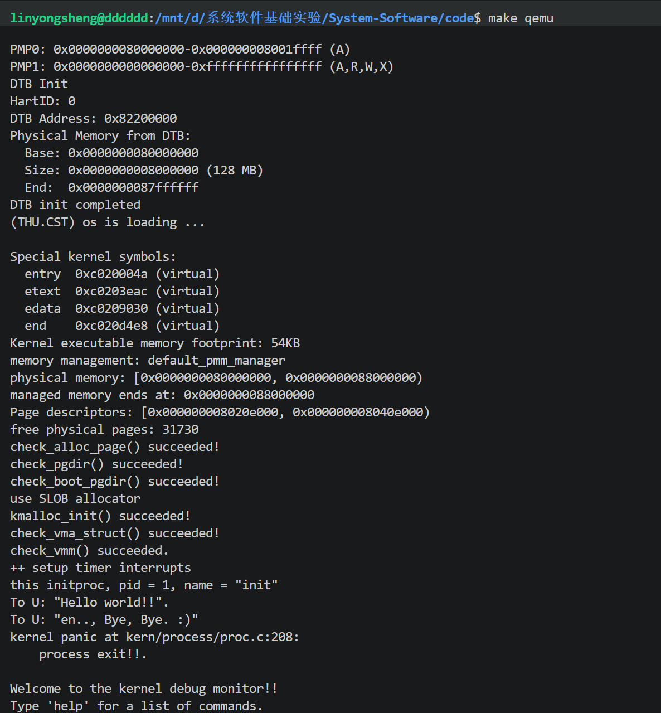
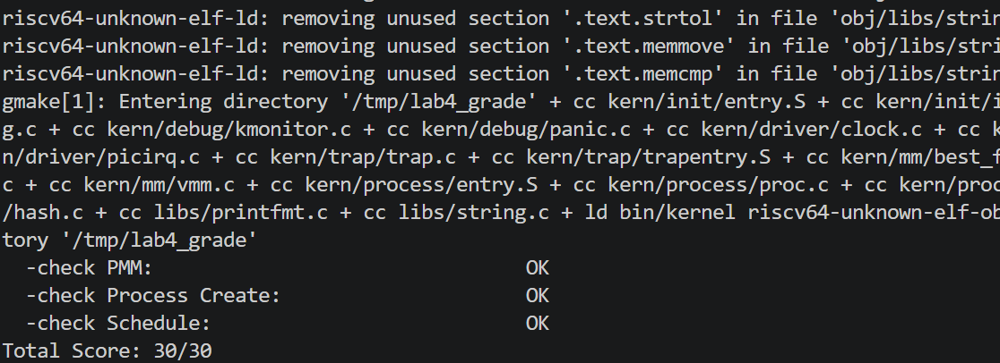

# 实验报告

## 实验基本信息

| 项目 | 内容 |
|------|------|
| **实验名称** | Lab4 进程管理 |
| **小组成员** | 2511107-林永盛、2511592-陈逍宇、2513411-邱宇湛 |
| **完成日期** | 2026-11-19 |

### 小组分工

| 成员 | 负责的练习/模块 | 报告分工 |
|------|----------------|----------|
| 2511107-林永盛 | 功能模块三：进程调度 | 公共部分、模块三和 Challenge |
| 2511592-陈逍宇 | 功能模块一：虚拟内存页操作 | 模块一的设计、实现和验证 |
| 2513411-邱宇湛 | 功能模块二：进程创建及初始化 | 模块二的设计、实现和验证 |

---

## 一、实验目的

1. 掌握 Sv39 下页映射的建立、更新和撤销，理解页表项、物理页引用计数与 TLB 的关系。
2. 理解内核线程的创建过程，掌握 PCB、内核栈、`context` 和 `trapframe` 的作用。
3. 掌握可运行线程的选择和切换过程，理解内核如何从 `idleproc` 切换到 `initproc`。

---

## 二、实验环境

| 成员 | AI 编程工具 | 底层模型 | 备注 |
|------|------------|---------|------|
| 2511107-林永盛 | Codex（终端 Agent） | GPT-6.2 Sol | 高 |
| 2511592-陈逍宇 | Codex（VS Code 插件） | GPT-6.2 Sol | 中 |
| 2513411-邱宇湛 | Codex（终端 Agent） | GPT-6.1 Sol | 高 |

AI 编程工具记录交互方式，底层模型记录生成代码时使用的模型。

---

## 三、实验整体逻辑分析

### 3.1 本章节的逻辑主线

本实验从内核地址空间出发，先建立和维护虚拟页映射，再创建内核线程，最后调度线程运行。启动时的执行现场登记为 `idleproc`，新建的 `initproc` 在第一次调度时接管 CPU 并执行 `init_main()`。

### 3.2 功能的逐步实现

1. **维护页映射。** `page_insert()` 和 `page_remove()` 更新末级页表项、物理页引用计数和 TLB，为内核地址空间提供页级映射管理。
2. **创建内核线程。** `proc_init()` 让 `idleproc` 复用启动栈，再通过 `kernel_thread()` 和 `do_fork()` 为 `initproc` 准备 PCB、内核栈和首次运行现场，并把它设为可运行。
3. **调度并启动线程。** `cpu_idle()` 检查调度标记，`schedule()` 选出 `initproc`，`proc_run()` 更新当前进程和页表，`switch_to()` 切换寄存器与栈。随后从 `forkret` 进入 Trap 返回路径，经 `kernel_thread_entry` 调用 `init_main()`。

---

## 四、实验内容与实现

<!--
说明：本部分按照 exercises 文档中的练习顺序组织
每个功能模块或者练习中可能包含多项任务，请根据实际情况调整
-->

### 功能模块一：虚拟内存页操作功能

**负责人：2511592-陈逍宇**

#### 模块功能描述

**需要实现/修改的 C 语言接口：**

```c
int page_insert(pde_t *pgdir, struct Page *page, uintptr_t la, uint32_t perm);(kern/mm/pmm.c)
void page_remove(pde_t *pgdir, uintptr_t la);(kern/mm/pmm.c)
```

**与之衔接的已有接口：**

```c
get_pte()、pte_create()、pte2page()、page_ref_inc()、page_ref_dec()、set_page_ref()、alloc_page()、free_page()、tlb_invalidate()、flush_tlb()
pde_t、pte_t、struct Page、pages、boot_pgdir_va
PTE_V、PTE_U、PTE_W、PTE_R
```

**功能说明：**

这个模块负责在现有多级页表框架上完成最基本的映射维护，也就是把物理页挂到指定线性地址上，以及把已有映射安全地撤销掉。

#### 关键状态和实现步骤
##### 关键状态

`page_insert()` 和 `page_remove()` 都会改变线性地址 `la` 的映射。实现时需要同时维护三项状态。

| 状态 | 在代码中的含义 | 更新要求 |
|---|---|---|
| 末级页表项 `*ptep` | `PTE_V` 表示该项有效，物理页号和权限位决定 `la` 指向哪一页、允许怎样访问 | 建立或替换映射时写入新页号和权限，删除时清零 |
| 物理页引用计数 `page_ref(page)` | 记录物理页持有的引用；每个有效映射贡献一个引用 | 新增映射加一，撤销映射减一。同一地址重新映射到同一页时计数不变 |
| TLB 中缓存的地址翻译 | CPU 可能仍缓存 `la` 对应的旧物理页或旧权限 | 先更新页表项，再使对应翻译失效，最后才允许回收旧页 |

##### `page_insert()` 的实现步骤

1. **取得末级页表项。** 先保存 `pgdir[PDX1(la)]` 的原值，再调用 `get_pte(pgdir, la, 1)`。参数 `1` 允许创建缺失的中间页表。若第一次分配成功、第二次失败，根表项已经发生变化，因此要恢复原值、刷新 TLB 并回收刚分配的页表页，然后返回 `-E_NO_MEM`。此时目标物理页的引用计数仍保持原值。
2. **判断原映射。** 若 `*ptep` 带有 `PTE_V`，用 `pte2page(*ptep)` 记下旧页 `old`；否则令 `old = NULL`。当 `old != page` 时，调用 `page_ref_inc(page)` 为新映射增加一个引用。若 `old == page`，说明此次操作只需更新权限。
3. **写入映射并刷新翻译。** 执行 `*ptep = pte_create(page2ppn(page), perm)`，用目标页号和本次传入的权限重新构造页表项。随后调用 `tlb_invalidate(pgdir, la)`。即使物理页相同，这一步仍然重要，例如撤销写权限后，CPU 需要丢弃缓存的旧权限。
4. **释放旧引用。** 若 `old` 存在且与 `page` 不同，调用 `page_ref_dec(old)`；计数降到零时才调用 `free_page(old)`。完成后返回 `0`。将回收放在最后，可以保证旧物理页重新进入分配器前，旧映射已经撤销。

##### `page_remove()` 的实现步骤

1. **只查询现有映射。** 调用 `get_page(pgdir, la, &ptep)`，同时取得物理页和末级页表项。其内部使用 `get_pte(pgdir, la, 0)`，查询过程不会分配页表。若中间页表缺失或末级页表项无效，直接返回。
2. **撤销映射。** 将 `*ptep` 清零，再调用 `tlb_invalidate(pgdir, la)`，使 CPU 丢弃该地址的旧翻译。
3. **减少物理页引用。** 调用 `page_ref_dec(page)`，仅在结果为零时释放物理页。因此，若两个地址都映射到 `p1`，删除第一个地址只会让计数从 `2` 降到 `1`，另一个地址仍能访问 `p1`；再次删除第一个地址时，查询已经找不到有效映射，计数仍为 `1`。这也就是删除操作的幂等性。
##### 最终提示词

以下是经过迭代优化后，最终成功实现该功能的提示词：

````markdown
## [PROMPT]

**任务**：在 `code/kern/mm/pmm.c` 的 `//LAB4 function1 YOUR CODE` 标记处，补全 `page_insert` 和 `page_remove`。两个函数共同维护 `la` 所在虚拟页的映射，使叶子页表项、物理页引用计数和 TLB 状态在操作完成后保持一致。

**操作要求**：直接修改项目中的实际文件。保留标记和既有逻辑，仅在标记对应的两个函数内进行必要修改。函数签名须与 `code/kern/mm/pmm.h` 中的声明一致。

**输出要求**：依据以下上下文和行为规格完成修改，以工程中的真实定义为准。完成后简要说明验证结果，区分已运行的测试和仅通过代码检查的情形。

## [RELY]

- `get_pte(pgdir, la, create)` 定位 `la` 对应的叶子页表项。`create` 为 `0` 时仅查找，为 `1` 时允许分配缺少的中间级页表页。返回非空指针表示叶子槽位存在，槽位内容含 `PTE_V` 才表示已有有效映射。
- 当前工程使用三级页表。`get_pte(pgdir, la, 1)` 可能在第一个中间级页表页已经分配并挂接后，因第二次分配失败而返回 `NULL`。`PDX1(la)` 可定位根表项，`pde2page()` 可取得有效中间级表项指向的页表页。
- `page2ppn(page)` 返回物理页号。`pte_create(ppn, type)` 使用物理页号和标志构造页表项，并自动置 `PTE_V`。`pte2page()` 可从有效叶子项取得 `struct Page *`。`PTE_U`、`PTE_R`、`PTE_W` 等权限位沿用工程定义。
- `get_page(pgdir, la, &ptep)` 仅查找已有映射。它返回映射的物理页，同时通过 `ptep` 提供叶子槽位指针。缺少中间级页表或叶子项无效时，返回 `NULL`。
- `page_ref_inc()` 和 `page_ref_dec()` 均返回更新后的引用计数。`free_page()` 回收一个物理页。`tlb_invalidate(pgdir, la)` 使指定地址的翻译失效，`flush_tlb()` 提供整体失效操作。

## [GUARANTEE]

交付以下两个现有接口，无需新增辅助函数或公开接口。

```c
int page_insert(pde_t *pgdir, struct Page *page, uintptr_t la, uint32_t perm);
void page_remove(pde_t *pgdir, uintptr_t la);
```

## [SPECIFICATION]

### `page_insert`

**Pre-Condition**：`pgdir` 指向有效页表根，`page` 指向已分配、可建立映射的受管物理页，`perm` 为调用者要求的页表标志。`la` 可以带有页内偏移，操作对象是其所在的虚拟页。

**Post-Condition**：成功返回 `0`。目标叶子项有效，指向 `page`，权限按本次 `perm` 设置；相关物理页的引用计数反映映射的实际增减。内存不足时返回 `-E_NO_MEM`，原有映射、引用计数和空闲页数量保持调用前的状态。

- **Case 1 · 原地址未映射**：建立映射，目标物理页的引用计数增加一次。若同一物理页已映射到其他地址，那些映射继续有效。
- **Case 2 · 原地址已映射到 `page`**：更新权限，清除旧映射中本次未请求的权限位。该物理页的引用计数保持不变，包括它仅有这一个引用的情形。
- **Case 3 · 原地址已映射到另一物理页**：将映射替换为目标页及本次权限。目标页增加一个引用，旧页减少一个引用。旧页引用归零时回收，仍有引用时保留。
- **Case 4 · 中间级页表分配失败**：撤销本次调用已经挂接的临时页表，归还对应页表页，保留调用前已存在的页表结构。目标地址不留下半完成映射，目标物理页不增加引用。

**Requirements**：新叶子项写入后，使 `la` 对应的 TLB 条目失效，包括仅更新同页权限的情形。若旧物理页需要回收，应先使旧翻译失效，再让物理页进入空闲集合。失败回滚涉及已挂接的中间级页表时，同样应在回收该页表页前完成必要的失效处理。

### `page_remove`

**Pre-Condition**：`pgdir` 指向有效页表根。`la` 可以带有页内偏移，其所在虚拟页可以已映射，也可以未映射。

**Post-Condition**：返回后，`la` 所在虚拟页无有效映射。其他虚拟页的映射保持原状。对同一地址重复调用不会重复减少引用或回收页面。

- **Case 1 · 存在有效映射**：清空目标叶子项，使该地址的 TLB 条目失效，并将原物理页的引用计数减少一次。计数归零时回收物理页，仍有引用时保留。已有中间级页表继续保留。
- **Case 2 · 不存在有效映射**：无论缺少中间级页表，还是已有叶子槽位但其有效位未置位，均直接返回。查找过程不分配页表页，不改变任何引用计数，也不回收页面。
````

#### 迭代过程

这两个函数的实现经历了三个阶段：先理清映射与引用计数的关系，再处理分配失败和重复删除等边界情况，最后从单独测试推进到完整内核验证。

1. **确定建立、替换和删除映射的规则。** `page_insert()` 先通过 `get_pte(pgdir, la, 1)` 定位末级页表项，再根据旧映射决定如何更新引用计数。原地址未映射时，目标页引用加一；原地址指向另一物理页时，新页引用加一，旧页引用减一；原地址已经指向目标页时，只更新权限，引用计数保持不变。`page_remove()` 则通过 `get_page()` 查询现有映射，只有找到有效映射才清除页表项并减少引用。

2. **补齐失败回滚，并确定旧页的回收时机。** 检查 `get_pte()` 的实现时发现，Sv39 页表遍历可能连续分配两张中间页表页。如果第一张分配成功、第二张失败，仅返回 `-E_NO_MEM` 会留下刚挂到根表上的空页表。因此 `page_insert()` 在调用前保存原根表项，必要时恢复它并回收新分配的页表页。对于成功的替换和删除，两个函数都先更新页表项，再使对应的 TLB 翻译失效，最后才释放引用计数归零的旧页。这样也保证了重复调用 `page_remove()` 时不会再次扣减引用。

3. **先单独验证，再验证完整启动路径。** 最初 Lab2、Lab3 的前置代码尚未补齐，因此先对 `pmm.c` 做 RISC-V 交叉编译，再用宿主模拟测试运行课程 PMM 断言，并额外验证两处分配失败时的回滚。补齐前置代码后，又在 QEMU 中运行完整内核，验证真实页表下的映射访问。`check_boot_pgdir()` 将同一物理页映射到两个虚拟地址，通过其中一个地址写入字符串，再从另一个地址读出相同内容。

#### 最终结果

`page_insert()` 能正确完成首次映射、同页权限更新和异页替换，成功返回 `0`，中间页表分配失败时回滚并返回 `-E_NO_MEM`。`page_remove()` 能安全撤销映射，保留仍被其他地址引用的物理页，对已删除或从未映射的地址可重复调用。

完整内核在 QEMU 中输出了 `check_pgdir() succeeded!` 和 `check_boot_pgdir() succeeded!`。课程评分中的 **PMM 项通过，获得 10/10**；包含进程创建和调度在内的 Lab4 总分为 **30/30**。

---
### 功能模块三：进程调度

**负责人：** 2511107-林永盛

#### 模块功能描述

- `cpu_idle()` 检查 `need_resched`，有调度请求时调用 `schedule()`。
- `schedule()` 在关中断期间清除请求，从当前进程之后轮转查找可运行进程。当前是 `idleproc` 时从表头开始，无可运行进程时回到 `idleproc`，并更新选中进程的 `runs`。
- `proc_run()` 切换到不同进程时更新 `current`，写入 Sv39 的 `satp` 并刷新 TLB，再调用 `switch_to()`。
- `switch_to()` 按 `struct context` 的布局保存和恢复 `ra`、`sp`、`s0–s11`。新线程沿 `forkret → forkrets → __trapret` 启动，已经运行过的线程从原切换点继续。

#### Spec 与 Prompt 的设计思路

以 PCB 和页表已经初始化为前置条件，分别约定调度选择、页表切换和寄存器恢复的结果。规格覆盖无可运行进程、切换到不同进程和恢复原中断状态。

#### 最终提示词

以下是经过迭代优化后，最终成功实现该功能的提示词。

````text
[PROMPT]
修改真实文件，补全Lab4模块三。保留标记，YOUR CODE改为2511107。
[RELY]
proc_list、current、idleproc、context、sync.h。
[GUARANTEE]
proc.c
void cpu_idle(void),proc_run(struct proc_struct*);
sched.c
void schedule(void);
switch.S
void switch_to(struct context*,struct context*);
[SPECIFICATION]
PCB与页表就绪。空闲循环见need_resched则调度。关中断清标记，轮转选就绪线程，无则回idle，更新runs。异进程更新current、写Sv39 satp并刷TLB。按context保存恢复ra/sp/s0–s11，返回后恢复中断。
````

#### 实现迭代过程

本模块的实现和联调分为两次迭代。

**第一次迭代**实现四个接口，定向编译通过。整机编译时，旧 `sbi.c` 与头文件内联接口发生重定义，两个 `readline.c` 也造成链接冲突。

**第二次迭代**保留头文件的 SBI 接口和 `kern/libs/readline.c`，去掉旧的重复源文件。QEMU 启动后，`initproc` 输出预期内容。教师评分中调度项为 `10/10`，整份 Lab4 为 `30/30`。

---

### Challenge：中断开关与多级页表

#### 1. `local_intr_save()` 和 `local_intr_restore()` 如何开关中断

`local_intr_save(intr_flag)` 读取 `sstatus.SIE`，把原值存到 `intr_flag`。原来为 1 时，`intr_disable()` 清除 SIE，使当前 hart 在 S 模式下暂停响应 S 模式中断。原来为 0 时继续保持关闭。离开临界区时，`local_intr_restore(intr_flag)` 仅在原值为 1 时调用 `intr_enable()`，重新置位 SIE。

`schedule()` 调用 `proc_run()` 时会再次保存中断状态。外层已经关中断，内层保存的是 0，所以内层返回时中断仍关闭。外层最终根据自己的保存值恢复，避免内层提前打开中断。

#### 2. `get_pte()` 中两段代码为什么相似

| 分页模式 | 虚拟地址的索引与偏移 | 页表层数 | 每级页表项 |
|----------|--------------------|------------|------------|
| Sv32 | 10 + 10 + 12 位 | 2 | 1024 项，每项 4 字节 |
| Sv39 | 9 + 9 + 9 + 12 位 | 3 | 512 项，每项 8 字节 |
| Sv48 | 9 + 9 + 9 + 9 + 12 位 | 4 | 512 项，每项 8 字节 |

三种模式的基本页都是 4 KiB。查表时，每一级都用相应的虚拟页号字段选出一项，遇到非叶子项就沿着它指向的物理页进入下一张表，遇到叶子项则得到映射。分页模式的差异主要是重复查表的层数和每级使用的索引宽度。参考 [RISC-V 特权架构规范](https://docs.riscv.org/reference/isa/priv/supervisor.html)。

本实验的 `get_pte()` 定位 4 KiB 页的末级槽位。第一段用 `PDX1(la)` 查根表，第二段用 `PDX0(la)` 查中间表。每段都检查对应项是否有效，缺表时根据 `create` 决定是否分配、清零并挂接下一级表，最后用 `PTX(la)` 定位末级项。Sv32 走到 4 KiB 叶子需要下降一次，Sv39 下降两次，Sv48 下降三次，因此可以复用相同的遍历逻辑。

#### 3. 查找与分配是否需要拆开

本实验保留 `get_pte(pgdir, la, create)` 就够用。查询和建表共用同一条遍历路径，`create=0` 用于只查找，`create=1` 用于按需分配，调用简洁。缺点是同一接口的副作用取决于参数，且分配多级页表时可能中途失败。例如 Sv39 的第一张下级表已经挂接，第二张分配失败，就需要明确由哪一层回收刚分配的页。

代码规模扩大时，可以保留共用的内部遍历函数，在外层提供“只查找”和“按需建表”两个入口，并在建表路径集中处理失败回滚。这样能让调用者直接看出是否会分配内存，同时复用遍历代码。

---

## 五、测试与验证

<!--
提供 make qemu 的编译及运行截图，以及一张 make grade 的评分结果截图。
-->

**测试截图：**



`make qemu` 输出了两项页表检查成功的信息，随后 `initproc` 打印 PID 1 和 `Hello world!!`。



`make grade` 的物理内存、进程创建和进程调度三项均通过，总分 `30/30`。

---

## 六、实验总结与收获

### 对操作系统的理解

| 知识点 | 原理与实验中的体现 |
|--------|--------------------|
| 多级页表与 TLB | 页表记录虚拟页到物理页的映射，TLB 缓存翻译。实验通过修改末级页表项和执行 `sfence.vma`，让处理器使用更新后的映射和权限。 |
| 物理页引用计数 | 一个物理页可以被多个虚拟地址引用。实验在创建和删除映射时维护引用计数，最后一个引用撤销后才回收物理页。 |
| PCB、内核栈与上下文 | PCB 保存线程的管理信息。内核线程共享内核页表，各自使用独立的内核栈。`context` 供线程切换使用，`trapframe` 保存 Trap 返回要恢复的现场，也可用于构造新线程的启动状态。 |
| 调度与中断保护 | 调度器选择下一个可运行线程，`switch_to()` 完成寄存器切换。本实验使用链表轮转选择，并用本地关中断保护当前 hart 上的切换过程。多核共享数据还需要跨核同步。 |

本实验未展开的 OS 知识包括用户程序加载与独立地址空间、进程退出及资源回收，以及时间片和优先级等调度策略。

### AI 协作开发的经验

提示词先写清修改位置和已有接口，再按正常、边界和失败情况明确结果。页映射要区分同页更新和异页替换，进程创建要写清失败清理，调度要覆盖无就绪线程及中断状态恢复。生成代码后先核对结构体和汇编的寄存器布局，再用 QEMU 和课程评分检查完整运行流程。
